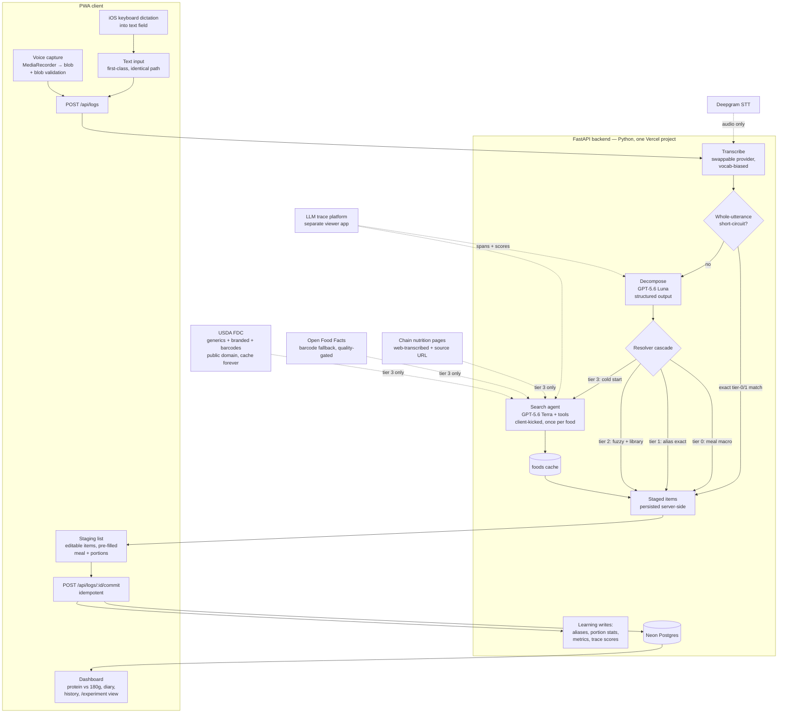

# Tally — System Design

**Name:** *Usual* (chosen 2026-08-20) — from "my usual breakfast," the phrase the resolver is built around. Repo stays `nutritiontracker`.
**Status:** Rev 6 · 2026-08-20 · amended 2026-09-03 (tenancy + demo accounts: §2, §4, §5, §7.4, §8.9)
**Companion:** [BRIEF.md](BRIEF.md) — the requirements this design answers. Section references (§) point there unless marked "below."
**Fact basis:** External claims (API tiers, ToS, iOS behavior, provider pricing/latency) were verified against official sources on 2026-08-20 by a research pass. This revision also incorporates a 4-reviewer adversarial critique (pain-point fidelity, feasibility, data integrity, completeness); every blocker and major finding is folded in.

---

## 0. The design on one page

**What it is:** speak or type what you ate → an editable, pre-filled list appears → one tap commits it to your diary. The app learns your foods, portions, and phrasings, so it gets faster every week — and built-in instrumentation proves whether that's actually happening.

| Layer | Decision |
|---|---|
| Frontend | Next.js PWA — installable, iOS-dictation-friendly; a bottom + opens the four ways to log (barcode · photo · search · voice); photo is the one estimation lane (§3.4b) |
| Backend | **Python FastAPI** — same Vercel project (Services), one origin; **Neon Managed Better Auth** (sessions in our own DB, JWKS-verified in FastAPI) |
| Models | GPT-5.6: **Luna** parses utterances, **Terra** runs the food-search agent (OpenAI Agents SDK) |
| STT | Deepgram Nova-3 (free via YC credits); OpenAI transcribe as one-env-var fallback |
| Database | Neon Postgres — diary, learned aliases + portions, full agent-trace archive; Row-Level Security keeps each account's rows apart, `foods` shared (§8.9) |
| Tracing | Langfuse Cloud free tier (official Python integration) + OpenAI Traces as bonus; prod/test split by environment |
| Food data | USDA FDC — whole foods *and* 433k branded products with barcodes, public domain, cache forever; Open Food Facts as quality-gated fallback; chain restaurants via agent web-transcription with stored source URLs |
| Shared types | Defined once in pydantic → TypeScript generated from OpenAPI, CI-enforced |

**How it stays fast:** a memorized phrase skips the LLM entirely (<300ms typed); anything logged before resolves from *your own history* in <50ms; only a never-seen food touches the network — once, ever, then it's learned.

**Cost:** ≈ $0/month after YC credits — Rev 5 deleted the FatSecret proxy, the last cash cost. No servers, no crons, no ToS timers.

**Still open:** confirm the device is an iPhone; your Cronometer baseline (days logged/week).

*Everything below is the build reference — read it when building, not to keep up.*

## 0.5 Before you build — accounts, keys, env

| Get | Why | Cost | Env var(s) |
|---|---|---|---|
| Vercel account (Hobby) + CLI | Hosting; **check the `services` beta key on the account** (fallback: classic `/api` hybrid) | free | — |
| Neon (via Vercel Marketplace) | Postgres | free | `DATABASE_URL` (use the **`-pooler`** string) |
| OpenAI API key | GPT-5.6 Luna/Terra + web search tool | ~$1–2/mo → **redeem YC/student credits** | `OPENAI_API_KEY` |
| Deepgram API key | STT | free via **$15K YC credits** | `DEEPGRAM_API_KEY` |
| USDA FDC key (api.data.gov) | All food data — whole foods, branded, barcodes | free, instant email signup | `FDC_API_KEY` |
| Open Food Facts | Branded/barcode fallback | free, **no key** — just a descriptive UA | `OFF_USER_AGENT="tally/0.1 (billzhangsc@gmail.com)"` |
| Langfuse Cloud (Hobby) | Traces + evals | free → **redeem $600 YC deal** for 90-day retention (Core) | `LANGFUSE_PUBLIC_KEY`, `LANGFUSE_SECRET_KEY`, `LANGFUSE_BASE_URL` (the v4 SDK name), `LANGFUSE_TRACING_ENVIRONMENT` (per Vercel env) |
| Neon Auth (Managed Better Auth) | Sign-in + sessions, enabled on the branch (Console or MCP) | free ≤ 60k MAU (Beta) | `NEON_AUTH_BASE_URL`, `NEON_AUTH_COOKIE_SECRET` |
| Owner address | The one unlimited account; every other sign-up is a demo (§8.9). Read by `backend/auth.py` (sign-up itself is open to any address), defaulting to the author's address | — | `ALLOWED_EMAIL` |
| Local toolchain | Dev | Node 22+, Python 3.12, `uv`, `pnpm` | — |
| **From you** | Design inputs | confirm iPhone · Cronometer baseline (days/week) — targets now come from the first-run goal wizard (§7.4) | seeds `settings` |

No FatSecret signup, no proxy, no cron — Rev 5 removed them all.

---

## 1. What we're building, in one paragraph

A Next.js PWA on Vercel, one owner per instance (other sign-ups are demo accounts, §8.9). Bill talks (or types) what he ate; a whole-utterance short-circuit catches memorized phrases instantly, and everything else goes through a Claude decomposition call that turns it into discrete items; a **tiered resolver** maps each item to a real food-database entry using *his own logging history first* and external food APIs only as the cold-start path; a staging list shows the proposal with meal and portion pre-filled; one tap commits it to a diary he owns in Postgres. Every commit teaches the resolver — aliases, portion defaults, meal patterns — so the app gets measurably faster with use. Instrumentation and LLM tracing record whether that's actually happening.

The three frictions from §2 map to three mechanisms, and only one involves a model:

| Friction | Mechanism | Where in this doc |
|---|---|---|
| Clicking through search results | Decompose → resolve → editable staging list | §3, §4 below |
| Selecting meal + time | Clock-window inference, pre-filled chip | §7.2 below |
| Selecting portions every time | Learned per-food portion defaults | §7.3 below |

Parse quality does not carry the experience; memory does. The design treats the LLM as a *parser and cold-start searcher*, never as a nutrition authority and never as the hot path — and for fully-memorized inputs, not even as the warm path (§3.0 below).

**The food-source decision, amended twice — final state: no FatSecret at all.** The brief (§3) fixed FatSecret with indefinite local caching. Verification (2026-08-20) broke that assumption twice over: FatSecret's terms allow only ids to be stored (all nutrition must be re-fetched within 24 hours), and it requires IP allowlisting that Vercel can't satisfy without a paid static-egress proxy. It was first demoted to branded-only; Bill then directed dropping it entirely. The final strategy, every piece live-verified on 2026-08-20:

- **USDA FDC for everything database-shaped** — SR Legacy/Foundation for whole foods, and **FDC Branded** for packaged goods: 433k current US products, CC0 public domain (cache forever — the exact opposite of FatSecret), monthly updates, barcode lookup via the `gtinUpc` field. Both canonical test products resolved live with accurate label panels (Core Power Elite 42g: current record, 232 kcal / 41.8g protein per bottle).
- **Open Food Facts as the quality-gated fallback** — ~956k US products, no key, ODbL/DbCL (private use carries no obligations, caching unbounded). Fallback rather than primary on evidence: the live spot-check found OFF's Core Power record *wrong* (53.8g protein/bottle vs the real 26/42g) while looking 79% complete — so OFF data always passes through staging with its quality flags displayed (§13).
- **Chain-restaurant items via agent web-transcription from official nutrition pages, with stored source URLs.** No free restaurant database survives in 2026 (MenuStat is offline, Nutritionix discontinued its free tier, FDC's chain entries are frozen at 2018) — but FDA menu-labeling law obliges every 20+-location chain to publish exact figures, so the authoritative data is always on the chain's own site. **Pure LLM estimation has no code path** — Bill's explicit rule (2026-08-20); transcription-with-provenance is the only custom-food mode. Details in §3.4a, §8.2, §13.

**A second amendment, by Bill's direction (2026-08-20).** The brief fixed Claude Opus 5 as the model; Bill has since directed the LLM stack onto **OpenAI's GPT-5.6 family** — `gpt-5.6-luna` for decomposition, `gpt-5.6-terra` for the tier-3 search agent, via the `openai` and `@openai/agents` SDKs — and promoted **Deepgram to primary STT**. Verified before adoption: GPT-5.6 left its staged preview and went GA on the self-serve API on 2026-07-09, so there is no availability gate. The changes land in §2, §3.4, §6, §8.1, §10, §11, §12, and §13.

**A third amendment, by Bill's direction (2026-08-20): the backend is Python.** Bill is most fluent in Python, and in a personal project that outweighs single-stack purity — especially since the move carries real wins: the Langfuse ↔ Agents SDK integration that is missing in JavaScript is official in Python (§10 sheds its workaround machinery), and the eval harness runs the *same* agent code as production. The frontend remains the Next.js PWA; the two live in one repo as two **Vercel Services** on one origin, and every shared type is defined once in pydantic with the TypeScript generated from FastAPI's OpenAPI schema (§2, §5). One flow was redesigned on verified platform limits: tier-3 kickoff is now a client-triggered request, because the Vercel Python runtime has no `waitUntil` (§3.4).

---

## 2. Architecture



Text input skips the STT stage and enters the identical pipeline — that's the §5 requirement that iOS audio flakiness degrades to typing, not breakage. On iOS the keyboard's dictation mic feeds the text field, which means **voice logging works from day one through the text path**, with zero dependence on the fragile MediaRecorder stack (§13 below). Transcription proper is behind a `Transcriber` interface (blob in, text out) so the provider is swappable without touching anything downstream.

**Stack.** One repo, one Vercel project (**Vercel Hobby** — its cron limits stopped mattering when Rev 5 removed the app's only scheduled job; §8.7), two services via **Vercel Services** — the current official pattern for exactly this Next.js-plus-FastAPI shape (beta, available on all plans including Hobby; *day-one task: confirm the `services` key is enabled on the account*, with the classic `/api`-inside-Next hybrid as the documented fallback). Top-level rewrites send `/api/(.*)` to the backend and everything else to the frontend — **one origin, so no CORS, and cookie auth works unchanged**.

- **`frontend/`** — Next.js App Router (TypeScript) PWA, Serwist via `@serwist/turbopack` (pin versions — single-maintainer project; SW behavior is only testable in production builds, so CI builds production).
- **`backend/`** — **FastAPI** (entrypoint `main:app`), Python 3.12, `pyproject.toml` + `uv`, deployed as one Fluid function with explicit `maxDuration` (120s) and `excludeFiles` to keep the bundle lean (Python bundles aren't tree-shaken, and cold-start time tracks bundle size). Packages, pinned: `openai` (3.x), `openai-agents` (0.22.x — pre-1.0, frequent releases), `langfuse` (**v4, ≥ 4.7.0** — v3 is deprecated with a hard Langfuse Cloud cutover on 2026-11-16), `openinference-instrumentation-openai-agents`, async `psycopg[binary]`. Postgres is Neon via the Vercel Marketplace, always through the **pooled** (`-pooler`) connection string: PgBouncer transaction mode fully supports the ordinary interactive transactions §3.5 needs — what it drops is cross-transaction session state (`SET`, temp tables), which this design never relies on.
- **Shared types, defined once:** every wire type is a pydantic model in the backend; FastAPI's `/openapi.json` feeds `openapi-typescript` (or `@hey-api/openapi-ts`, FastAPI's own docs' pick, if a typed client is wanted) to generate the frontend's TypeScript, and a CI no-diff check makes drift unmergeable.

**Auth: Neon's Managed Better Auth** (Bill's call, 2026-08-20; verified against Neon docs same day). It's the managed auth built into Neon — Beta, built on Better Auth, free to 60,000 MAU — and its best property for us: **users and sessions live in our own database under the `neon_auth` schema and branch with it**, so auth works on dev/preview branches and slots straight into §10's environment split. Wiring: the Next.js side mounts the SDK's catch-all route + session cookie (`@neondatabase/auth/next/server`); for API calls the client attaches the short-lived JWT from `authClient.token()` (15-min expiry, auto-refreshed) as a Bearer header, and **FastAPI verifies it offline against the JWKS endpoint** (`{NEON_AUTH_BASE_URL}/.well-known/jwks.json`, EdDSA/Ed25519 — Neon documents the exact PyJWT snippet; cache the keys). State-changing requests with a mismatched `Origin` are rejected. No cron routes anywhere.

**Accounts and tenancy (2026-09-03, the open-sourcing change).** Any JWT-verified account is allowed in: `require_user` returns `{id, email, is_owner}` where `id` is the token's `sub` (the Neon Auth user id) and `is_owner` is whether the email matches `ALLOWED_EMAIL` (default: the author's address). The owner is unlimited; every other account is a **demo** with a daily quota (§5, §8.9). **Tenancy is enforced by the database, not by the queries:** `require_user` puts the user id in a contextvar (`db.current_user_id`), and every transaction `db.py` opens — `tx()` and the single-statement helpers alike, which is why each helper now runs as its own short transaction rather than a bare autocommit statement — first binds the tenant in one round trip: `SET LOCAL ROLE tally_app; SELECT set_config('app.user_id', <id>, true)`. Transaction-local by design: PgBouncer transaction mode does not keep session state across transactions, so a session-level `SET` could land on a different server connection than the next statement. The role switch is load-bearing, not decoration: on Neon the connecting role (`neondb_owner`) carries `BYPASSRLS`, which even `FORCE ROW LEVEL SECURITY` cannot override and no superuser is available to strip, so migration 002 creates `tally_app` (NOLOGIN, no BYPASSRLS, plain table privileges) and the app runs every statement as it. Row-Level Security policies on the user-owned tables (§4) then compare each row's `user_id` to the setting. With no user bound the setting is `''`: the policy matches nothing, and the column default — `nullif(current_setting('app.user_id', true), '')` — is NULL, so an insert fails. Fail-closed by construction. Code paths with no request bind the owner explicitly: `evals/common.bind_owner` looks the id up in `neon_auth."user"` by `ALLOWED_EMAIL` on a plain connection (the app role cannot read that schema) and sets the contextvar; the migration runner does the same lookup inside its own transaction.

**No off-Vercel infrastructure remains.** Rev 5's FatSecret removal deleted the static-egress proxy, the daily refresh cron, and the attribution requirement in one stroke — every food source is now keyless or free-key, IP-unrestricted, and permissively cacheable. The whole system runs on free tiers with zero servers to babysit. (OFF asks for a descriptive `User-Agent` header on every call — `usual/x.y (billzhangsc@gmail.com)` — and gets a courtesy footer credit; neither is a legal obligation for private use, both cost nothing.)

---

## 3. The resolver cascade — precise algorithm

The resolver takes one `ParsedItem` (from decomposition, §6 below) and returns a `StagedItem`. Tiers 0–2 are local DB reads, deterministic, and sub-50ms. Tier 3 is the only network path and runs asynchronously per item. **All staged state is persisted server-side** in `item_resolutions` (§4) — the client is a renderer of that state, which is what makes polling, late resolution, question round-trips, and recovery implementable.

### 3.0 Normalization and the whole-utterance short-circuit

Every phrase is normalized before any lookup, and aliases are stored normalized:

```
norm(s) = NFKC → lowercase → strip punctuation → collapse whitespace
        → drop leading articles/possessives ("a", "an", "the", "my", "some")
```

Plural/singular variance is *not* normalized away — the trigram stage (tier 2a) absorbs it. Quantities never reach `norm()`; decomposition splits "two eggs" into `qty: 2, phrase: "eggs"`.

**Short-circuit — the LLM leaves the hot path entirely.** After capture (and after STT for voice), before any model call:

```
key = norm(entire raw input)
if key matches meal_macros.trigger_phrases          → tier 0, stage directly, skip decompose
else if key matches aliases.alias_norm (any rows)   → tier 1, stage directly, skip decompose
else                                                → decompose (gpt-5.6-luna), then per-item cascade
```

A memorized phrase — the single hottest input in the system by week two — stages in one DB round-trip: **&lt;300ms typed, ~2s spoken (STT only)**. Compound or quantity-bearing utterances ("usual breakfast and a coffee", "two fairlifes") won't whole-match and fall through to decompose unchanged, so nothing is lost. The skip is recorded (`logs.short_circuit`), so the /experiment latency curve shows the effect instead of flattening at the decompose floor — without this, `staged_ms` would hit a permanent ~2s LLM floor exactly when the aliases saturate, and the "gets faster every week" hypothesis would become unmeasurable.

### 3.1 Tier 0 — meal macro expansion

```
if norm(phrase) exactly matches any meal_macros.trigger_phrases entry (macro active):
    expand → one StagedItem per macro item, each already carrying
             {food_id, serving_id, qty} from the stored macro
    record one resolution row PER EXPANDED ITEM, tier 0 (each with its own
    item_index — per-item remove, commit, and telemetry all depend on this)
```

Pure expansion. No search, no LLM, no portion inference — the macro stores exact portions. `trigger_phrases` are stored as `norm()` output and the meals API applies `norm()` on write — e.g. `{'usual breakfast', 'usual'}`, **not** `'my usual breakfast'`/`'the usual'`, which post-norm inputs could never equal.

A macro's **name** is matched too, but only after every trigger has failed. §6.1 shows decompose the saved-meal *names*, so a `meal_ref` can come back as a name the triggers no longer carry — the Library can edit a trigger away from `norm(name)`. Trigger matches always win; among equals, the most recently updated macro does.

Four rules that prevent quiet corruption:

- **Tier-0 expansions never write aliases or portion defaults** (§3.5). The macro itself is the memory. Without this rule, committing a 4-item breakfast would upsert four conflicting aliases for "usual breakfast", which would lie dormant until the macro is deactivated and then resolve his whole breakfast to a single egg.
- **A meal-shaped phrase with no matching macro never enters food search.** Decomposition tags meal references (`meal_ref` / `phrase_kind`); if no macro matches, the row becomes `needs_input`: *"No saved meal called 'usual lunch' — log the items, then tap Save as meal."* Sending "usual lunch" to a food-database search would return junk and make the headline feature's first use a dead end.
- **A spoken quantity means he is talking about a food, not a meal.** A macro is a meal reference and stores its own portions, so tier 0 stands aside when decompose tagged the phrase `food` *and* heard a qty — "two eggs" resolves through tiers 1–3 at the qty he said, even if a macro happens to be triggered by "eggs". A `meal_ref`-tagged phrase still expands; the qty is simply not a thing a macro can honour.
- **A macro that cannot expand in full expands not at all.** Foods are cache-forever, so a stored item pointing at a missing `foods` row means the macro is broken, not that the item is optional. Expansion counts what it could not find and the row becomes `needs_input`: *"Saved meal 'Usual breakfast' is missing 1 of its 3 foods — fix it in Library, then log it again."* The two failure modes this replaces are both silent lies: logging the surviving items would under-count a meal he believes he logged whole, and reporting the all-missing case through the previous bullet's guard would claim a saved meal he can see in Library does not exist.

### 3.2 Tier 1 — exact alias match

```
rows = SELECT * FROM aliases WHERE alias_norm = key
if rows.length == 0: continue to tier 2
usual = pick(rows), resolve → usual, tier 1, alternates = other rows (≤3)
```

`pick()` — the "usual" selection — is **recency-and-intent aware, not lifetime-count based**:

```
1. a pinned alias wins (explicit "make this my usual")
2. else most recent last_explicit_at within 90 days      -- an explicit choice: a
   (chip tap, disambiguation, staging food-edit)            correction flips the very
                                                            next default
3. else mode of the last 10 committed choices for this
   alias_norm (from item_resolutions), tie → most recent
4. else use_count DESC, last_used_at DESC
```

Lifetime `use_count` ranking has a failure mode the critique made concrete: one wrong food committed 20 times keeps beating the correction for ~20 more logs, and every rushed zero-edit commit widens the gap. Rule 2 makes a single explicit correction the new default immediately; passive accepts (committing the pre-selection untouched) update `use_count`/`last_used_at` but are not "explicit." Switching away from a pre-selection also increments the loser's `rejected_count` — negative evidence, surfaced in the alias sheet.

This is the "a fairlife" case. When the phrase is ambiguous *within his own history*, we neither silently guess nor dump a list: the staged row arrives **pre-selected to the usual with alternates rendered inline as one-tap chips**:

> **Core Power Elite chocolate** *(usual, 60×)* · [2% milk?]

Committing without touching it accepts the usual — zero extra taps in the common case, one tap to switch. **The alternates chip renders whenever more than one alias row exists** (the brief's "do not silently guess" is categorical); liveness (`second.use_count ≥ 0.2 × top` or used within 30 days) governs prominence, not presence — so a rival he hasn't logged in two months is a quiet chip, not an invisible one.

### 3.3 Tier 2 — novel phrasing, known food

Two independent matchers run against *his personal corpus only* (never the global databases):

- **2a — trigram:** trigram similarity of `key` against `alias_norm` (pg_trgm — available on Neon's free plan). **Use an explicit `similarity(alias_norm, key) >= 0.55` predicate**, keeping the `%` operator only as the index-accelerated prefilter — `%` alone reads the session-level `similarity_threshold` GUC (default 0.3), and `SET` does not survive PgBouncer transaction pooling — the threshold must live in the query, never the session. Top 3 by `sim DESC, use_count DESC`. Catches plurals, typos, word-order flips, partial phrases.
- **2b — semantic, via the decompose call:** the decomposition prompt includes his **personal food index** — by Bill's sizing (2026-08-20): the top **20** foods inline by default (a few hundred tokens; the maintained index caps at ~100, and the tier-3 agent can pull more via `get_food_history`, §3.4), as `(index_id, display name, brand)` lines. The model tags each parsed item with `library_match: index_id | null` when the phrase is semantically the same food ("protein shake" → Fairlife Core Power). The resolver validates the id exists; an invalid id is discarded. Zero extra latency, zero extra infrastructure.

Combination rules — **exhaustive** over (2a strong ≥0.75 / 2a weak 0.55–0.75 / 2a none) × (2b hit / 2b none), plus the disagreement case:

```
1. 2a hit (any sim ≥ 0.55) and 2b agree on food_id   → resolve, tier 2, high confidence
                                                       (two independent matchers agreeing is
                                                        corroboration regardless of sim strength)
2. exactly one matcher fired, strongly
   (2a sim ≥ 0.75 alone, or 2b alone)                → resolve it, tier 2, row styled "verify me"
3. only weak 2a (0.55–0.75), no 2b                   → resolve top, tier 2, alternates chip
                                                       + "search instead" affordance
4. both fired, different food_ids                    → resolve 2b (semantic beats lexical),
                                                       2a top shown as alternate chip
5. neither                                           → tier 3
```

Rule 4's ordering is a judgment call: trigram false-positives ("chicken salad" ≈ "chicken salt") are more common than semantic ones. Whichever wins, the loser is one tap away, and the commit writes an exact alias so this phrase never reaches tier 2 again — tier-2 nondeterminism (2b involves a model) is structurally confined to the *first* encounter of a phrasing.

### 3.4 Tier 3 — cold start: LLM-driven search over three sources

Runs per unresolved item as a **client-triggered follow-up request**: `POST /api/logs` returns the staging list immediately with unresolved items marked `searching`, and the client fires one `POST /api/resolve/tier3 {log_id, item_index}` per such item. That request runs the agent *synchronously* (3–8s — trivially inside Hobby Fluid's 300s limit) and writes the result; the poll (or the response itself) updates the row. This replaces the earlier `waitUntil` design deliberately: the Vercel Python runtime has **no `waitUntil`**, and FastAPI `BackgroundTasks` after the response has no reliability contract there — a plain synchronous request is both supported and simpler. The agent itself: the Python Agents SDK (`openai-agents`) — `gpt-5.6-terra`, `@function_tool` tools with pydantic parameters, a pydantic `output_type` producing the structured answer below, `max_turns=6` explicit, `await Runner.run(...)` directly inside the async FastAPI route — with source-routed tools:

- `search_generic(query)` → USDA FDC `/v1/foods/search`, `dataType=SR Legacy,Foundation`, condensed: `{fdc_id, description, data_type, protein_per_100g}`
- `search_branded(query)` → **FDC Branded** (433k current US packaged products) — results ranked/filtered by `brandOwner`, because plain name search is fuzzy-noisy (a "Quest" query returns 123k hits with competitors ranked first, verified live). Barcode lookups use field-scoped `gtinUpc:` queries with a **normalization ladder** (as-scanned → leading zeros stripped → zero-padded to 13 and 14 digits) — stored `gtinUpc` lengths are inconsistent and matching is literal, verified failing in both directions otherwise.
- `search_off(query_or_barcode)` → Open Food Facts, **fallback only** when FDC Branded misses: v3 product-by-barcode + search-a-licious text search, mandatory User-Agent, 503-backoff (limits: 15 reads/10 searches per minute, actively enforced). OFF results always carry their `completeness`, `data_quality_warnings_tags`, and `last_modified_t` into staging (§13).
- `web_search` → the hosted `WebSearchTool` (the Responses API `web_search` tool; ~$0.01 per search action + content tokens), **for the web lane — chain/restaurant items (rule 2a) and, since 2026-09-06, packaged/retail products the databases miss (rule 2b)**: `filters.allowed_domains` pinned to the chain's, the brand's or the retailer's official site, `response_include=["web_search_call.action.sources"]`, `url_citation` annotations captured. Feeds `add_food` (below), never `entries` directly. A companion `fetch_page` function tool (plain `httpx` GET + text extraction) exists as the deterministic fallback for JS-calculator/PDF chain sites the hosted tool handles poorly (§13).
- `get_food(source, id)` → full detail. **Results are held in the agent run's working memory; only the *chosen* food is persisted to `foods`** — dedup hygiene, one row per real-world food. Alternates are stored as bare `(source, source_id)` pairs, re-fetched on demand if tapped.
- `get_food_history(n=20)` → his food history on demand: top-n foods by recency/use (default 20, capped at the maintained ~100) — lets the agent see beyond the small inline index without bloating every prompt (Bill's sizing, 2026-08-20).
- `add_food(...)` → the custom-food gate, §3.4a below.

**Failure lifecycle (specified, because the kick now lives client-side):** each `POST /api/resolve/tier3` increments `tier3_attempts` and stamps `tier3_started_at`. If the invocation dies mid-run (deploy, crash, phone pocketed), the item simply stays `searching`; the GET poll handler flags any `searching` item older than 60s as stale, the client re-kicks a stale item **once**, and after that the server flips it to `not_found` (manual search box). The client polls at 1s with backoff to 2s and hard-stops at ~90s; a log reopened later (app closed mid-search) shows the stale row and re-kicks or falls back the same way. No item can spin forever.

**Local candidates, always supplied:** before the agent runs, the resolver computes trigram matches of the phrase against `foods` — **with no similarity floor** (top-N by similarity, however weak) **plus his top-10 foods by use_count**. The threshold-free rule matters: SR Legacy names are verbose ("Chicken, broilers or fryers, breast, meat only, cooked, roasted"), so a terse phrase like "grilled chicken" would miss any reasonable cutoff and the dedup net would no-op for exactly the staples it protects. Each food also stores a short `display_name` (set at cache time by the agent; human text, never nutrition) which is what the trigram index runs against. Agent instruction: *"if one of these already-cached foods is the same real-world food, choose it — do not create a second identity for the same food."*

**Ranking and routing rules** (verbatim into the agent's system prompt):

1. **Generic/whole food** ("chicken breast", "broccoli", "rice") → `search_generic`. Prefer **SR Legacy** entries for cooked staples — verified live: Foundation entries are mostly raw commodities with partial nutrient panels (a Foundation raw chicken breast carries 26 nutrients, no B-vitamins or selenium), while SR Legacy carries ~130 including full vitamin/mineral panels. Foundation is acceptable for raw/simple produce.
2. **Branded SKU** ("fairlife", "quest bar") → `search_branded` (FDC Branded), falling back to `search_off` on a miss. Prefer the branded entry even though it carries fewer micronutrients — substituting a generic for a specific product is worse data, not better. Prefer fresher records (`dataSource` GDSN over LI-era; surface `publishedDate` when it's years old).
2a. **Restaurant/chain item** ("the pesto thing from Sweetgreen", "a Big Mac meal") → `web_search` against the chain's official nutrition page, then `add_food` with transcribed values + source URL (§3.4a). FDC's frozen 2018-era chain entries (SR Legacy) serve as a sanity cross-check only.
2b. **Packaged/retail product the databases miss** ("costco tonkotsu ramen", a store brand, a new SKU — Bill's ask, 2026-09-06) → first identify the product (the brand and the exact item; one unpinned `web_search` may do it) and retry `search_branded` under that name; only when FDC Branded has no match, the same web lane as 2a pinned to the **brand's or the retailer's official domain** (the manufacturer's site, or the retailer's product page showing the Nutrition Facts panel), transcribed exactly as published into `add_food(source="web")`. Never a recipe site, a nutrition aggregator, or memory; nothing official → `not_found`. The same code gates apply: the pin is required before a web food can be added, the `source_url` must sit on the pinned domain, and the evidence gate drops a food whose page the run never consulted. `tests/test_agent_live.py` runs the phrase end to end.
3. **Cooked vs raw:** if the phrase or `state` field disambiguates, match it; otherwise prefer the cooked entry for state-sensitive foods.
4. **Query refinement allowed:** if results are junk, refine and retry ("protein bar" → "Quest protein bar chocolate chip cookie dough"; FDC's ranking is quirky — "chicken breast cooked" surfaces breaded tenders above plain roasted breast, and a more specific query fixes it). If the missing information is unknowable (which brand?), return a `question` instead of guessing.
5. **Never mix sources for one food.** A food identity lives in exactly one `(source, source_id)`.

### 3.4a `add_food` — the custom-food gate and the provenance rule

`add_food` is how anything outside the databases enters `foods`, and it has exactly **two modes**:

1. **`from_source(source, id, serving?)`** — cache a database entry (the normal path, formalized as a tool so the agent's final action is always explicit).
2. **`web_transcribed(...)`** — for items no database has (chain meals, new products). Requires, schema-enforced: `source_url` (the official page), the `url_citation` list from the search call, and per-field values *as read from the page*. The resulting food row stores `source='web'` with `source_url` + `provenance`; its staging row (and diary display) renders **visually distinct with the citation as a visible, clickable link** — which is an OpenAI usage-terms requirement for web-search content, not just taste. Nothing commits without the user's confirm, same as every other row.

**Estimation is mode-scoped (Bill's rule, 2026-08-20): text and voice never estimate — no code path, unchanged. Photo (M4) is the one lane where estimation is permitted**, because a photo can identify foods but must guess portions. Even there, identified foods resolve against the databases wherever possible; estimation covers only what vision can't know (portions, unresolvable items), and estimated values render visually flagged — like web-sourced foods — and never commit without confirmation. The accuracy literature is why the flag matters: best models ~67% within ±7g of carbs, protein errors up to 60% in photo studies.

**Cooked/raw is enforced in code, not just prompt** — it's the brief's named "single most common way people silently miss a protein target," so it can't hang on the agent obeying rule 3. The source adapters parse `state` from the entry name ("cooked, roasted" / "raw") and set `state_sensitive` from a deterministic term list (meat, fish, rice, pasta, legumes — same list as the prompt). If a resolved food is state-sensitive and neither the parsed `state` nor the entry name disambiguates the *user's intent*, the resolver — regardless of agent output — sets `state_question: true`. The toggle's target is resolved lazily: first toggle fires one targeted `search_generic` for the counterpart entry (once, then both ids live in the alias). The answer persists into the alias, so it's asked at most once per phrase.

**FDC adapter rules** (code, not prompt — all verified against live API responses): map nutrients by stable id (1003 protein, 1004 fat, 1005 carbs, 1008 energy) with a fallback to the Atwater energy ids for Foundation foods; skip null-amount category-header rows; tolerate HTTP 404 on an fdcId that search just returned (observed live — stale index entries); treat absent micronutrients as *not measured*, never zero. Foundation/SR Legacy values are already per-100g; `foodPortions[].gramWeight` supplies household servings. **Branded additions:** each record carries both bases in one fetch — `labelNutrients` (per serving, as labeled) and `foodNutrients` (per 100g/ml) — normalize both into the cache; map GS1 serving units (`GRM`/`MLT`/`OZA` → g/ml/fl-oz) for GDSN-sourced records; sanity-check absurd units (a live Clif record claimed a "68.0 MG" serving); get a free api.data.gov key day one (`DEMO_KEY` is 30 req/hr shared-per-IP and was rate-limited for an entire research session).

**Structured output** of the agent:

```ts
{ status: "resolved" | "needs_input" | "not_found",
  food_id?, serving_id?, display_name?,     // short human name for the row + trigram index
  confidence: "high" | "medium" | "low",
  alternates: [{source, source_id, label}],  // ≤ 3, ids not payloads
  question?: { text: string,
               options: [{label, source?, source_id?}] } }  // ids when the agent already saw them
```

`needs_input` renders as a question chip on the row ("Which brand? Quest · Pure Protein · other"). **Options carry ids when the agent has already seen the candidates** — tapping one resolves locally with a single `get_food` (~instant), no second agent run. Free-text re-entry (a second agent run with the refinement) is reserved for genuinely unknowable answers. Without this, the cold-start path would be wait-3-8s → tap → wait-3-8s-again for a food the agent was just looking at, ~25 times in week one. `not_found` flips the row to a manual search box (a plain two-source search UI — the escape hatch, deliberately boring).

The agent **never outputs nutrition numbers**; it only ever selects database ids (plus display strings). There is no code path from model output to the `entries.macros` field except through a cached `foods` row. **The one documented exception is mode 2 above:** the web-transcription lane's cited values do pass through the model — transcribed from the pinned official page, evidence-gated (BACKLOG 37/38), never estimated — into a `source='web'` foods row, and from there into `entries.macros` like any cached row. It is the only model-sourced path to macros in the system; the photo lane (§3.4b) adds no second one — vision's schema has no nutrition field, and its numberless `"unresolved"` row carries no numbers at all. **The one documented exception is mode 2 above:** the web-transcription lane's cited values do pass through the model — transcribed from the pinned official page, evidence-gated (BACKLOG 37/38), never estimated — into a `source='web'` foods row, and from there into `entries.macros` like any cached row. It is the only model-sourced path to macros in the system; the photo lane (§3.4b) adds no second one — vision's schema has no nutrition field, and its numberless `"unresolved"` row carries no numbers at all.

### 3.4b The photo lane — vision decompose, flagged estimates, explicit confirm (M4)

The photo is the one capture adapter that emits `ParsedItem[]` from pixels rather than words (§12 M4). `POST /api/logs/photo` (multipart: `image`, `id`, `captured_at`, `meal_hint?`, `tz?`) validates the upload twice — declared content type **and** magic bytes, JPEG/PNG/WebP only, 12 MB cap, HEIC refused by name because the vision API does not take it — then hands the bytes to `services/vision.py`: one `gpt-5.6-luna` Responses call (image input verified on the model page and the images-vision guide, 2026-09-02; luna is decompose's tier, and terra also accepts images if accuracy ever proves insufficient) with a strict schema of `{items: [{phrase, qty, unit, est_grams, confidence, note}], meal_hint}`. **The schema has no nutrition field and the instructions forbid numbers in free text** — vision identifies and measures; it never computes. Each item becomes a `ParsedItem` whose estimate rides the §7.3 spoken-quantity channel (a count for countable items, else `est_grams` as grams) into `cascade.resolve_item` — the identical tiers 1–3, tier 0 skipped because a saved-meal trigger is something you *say* — and `routes/logs._persist` writes the rows with `input_mode='photo'`.

What the lane adds is the flag: three fields on `StagedItem` (§5) — `estimated: "none" | "portion" | "unresolved"` (default `"none"`, so text and voice rows are untouched), `estimate_note` (user-facing: what vision saw), and `estimate_confirmed` (written by exactly one route). The rules, each enforced in code:

1. **A resolved database food whose amount came from the photo is `estimated="portion"`.** `routes/photo.py _flag` maps the estimate onto the food's *own* servings — a count onto a household serving, else `est_grams` onto the 100 g / gram serving — and recomputes macros from the cache. The numbers are database numbers; only the amount is a guess. Vision's identification confidence caps the row's confidence at every level — low, medium and high alike, so a `medium` vision call caps a high-confidence tier-1 row at medium; a row vision could not size keeps the resolver's usual portion, unflagged.
2. **A row nothing resolves becomes a numberless estimate row, `estimated="unresolved"`** — a photo item with no database match. When tier 3 returns `not_found` on a row whose staged jsonb carries `vision` (the kick, an answer re-kick, or an edited-phrase re-resolution), `routes/photo.stage_estimate_food` persists what vision saw as a `foods` row with `source='estimate'`, `provenance = {vision item, model, captured_at, log_id, item_index}` and an **empty macros block**, and stages it resolved with `search_instead`, answering with the row *as stored* (its note included). It carries **no numbers**, cannot be confirmed (`confirm-estimate` 409s) and cannot commit (the core-macros guard, and rule 3's gate) — **Search is the way out**: the search sheet's pick swaps a database food in while the photo's portion (still in `spoken_qty`) applies to it. No model ever outputs calories for it: §3.4a's "only path to `entries.macros` is a cached foods row" holds, and the placeholder is invisible everywhere else — `/api/foods/search` hides `source='estimate'` rows, `/api/logs/from-food` and the answer chip refuse them (422 *photo-lane placeholder — pick a database food*), `/api/foods/select` takes database sources only, and tier 3's local-candidate pool excludes them, so a spoken phrase can never resolve to one. The placeholder is also the photographer's alone (§8.9): its provenance is that tenant's photo, so `GET /api/foods/{id}` answers it only to the account whose log it names — 404 to everyone else, as an unknown id — trimmed of the pointers (`log_id`, `item_index`, `captured_at`) and the raw `payload`; and `POST`/`PATCH /api/meals` refuse it like every other pick path (422).
3. **Nothing estimated commits without an explicit confirm, server-side.** `POST /api/resolve/confirm-estimate {log_id, item_index}` sets `staged.estimate_confirmed=true` on a live row (409 on committed, removed, unflagged or numberless rows). `resolver/commit.py` decides the gate from the **stored rows only** — the payload can rename, re-index, relabel ("searching"), un-flag or omit a row and it changes nothing: every uncommitted stored row still carrying an unconfirmed flag blocks when it is resolved server-side *or* when the payload would commit it as resolved, and on a photo log a committable payload item with no stored row at all is refused outright (`photo log has no staged row for items [..]`), so nothing commits *around* a flagged row either. The whole commit is refused before any write with 409 `confirm the estimated rows first: [indexes]`; the late `commit-item` path runs the same gate over its one row. The payload rules the gate rides on — one payload item per `item_index`, removed rows never resurrected, the write loop committing exactly the gate-checked view — are stated in §3.5. Editing the portion in the portion sheet does *not* confirm; the committed payload records the stored flag and confirmation, whatever the client sent — a row the server never stored (text/voice) is written `"none"`.
4. **The flag survives every rewrite, and only ever downgrades.** `KEEP_LOG_KEYS_SQL` carries `vision`, `estimate_note` and `estimated` through tier-3 results, `/api/resolve` re-resolutions, answers and search picks; `"portion"` stays `"portion"`, and an `"unresolved"` row that gains a database food becomes `"portion"` only when vision actually sized the item (a count or `est_grams` — that portion rides the spoken-quantity channel into the pick); when vision sized nothing, the pick's portion is the resolver's own and the row is honestly `"none"`. `vision` rides outside the null-stripping wrapper, so an unsized item's `qty`/`est_grams: null` reach the eval loop intact. `estimate_confirmed` is deliberately *not* carried — any re-resolution needs a fresh confirm.
5. **Photo rows learn nothing** (§3.5) — on both sides of the table. *Write side:* commit — and the diary's `PATCH /api/entries/:id` food correction — read `logs.input_mode` and skip the alias upsert and the portion-default recompute for `photo`, `barcode` and `search` logs. *Read side:* commit still writes `final_*` for every row (the diary needs them), so every learning read over committed `item_resolutions` — `cascade.pick()` rule 3, `cascade.resolve_portion` steps 2–3 (which `tier3._apply_portion` goes through) and commit's alias-default recompute — appends `LEARNABLE_ROWS_SQL`: the row's log must be a spoken one (`input_mode` not in photo/barcode/search) *and* the row must carry no estimate flag, whatever its log says. There is no phrase worth remembering, and a photo-estimated 1.5 × 100 g or a barcode pick must never become the next spoken log's default.
6. **The image bytes are never persisted** (§8.8). Each row's `staged->'vision'` keeps the raw structured output plus the model id for the eval loop; the trace records the mime type and byte count, never the image.

The UI half (§7.1): an estimated row renders an amber *estimate* badge, muted `~kcal`, a note line, and a *Confirm estimate* chip; the Commit button is disabled with the reason until every *resolved* estimated row is confirmed (a numberless row says to pick a food with Search, or remove it). A photo row still in tier 3 never blocks the rest (§7.1): it commits as a §3.5 straggler, and the pending pill offers its *Confirm* when it lands — `commit-item` refuses it until then. Every resolution response (the kick, an answer, a search pick, `/api/resolve`) returns the row *as stored*, flag included, so a re-resolved photo row never renders unflagged. A committed photo portion stays flagged in the diary: `GET /api/diary` reads `estimated` off each entry's `item_resolutions` row, and Today's list and `/history/[date]` render the same *estimate* badge. A committed photo portion stays flagged in the diary: `GET /api/diary` reads `estimated` off each entry's `item_resolutions` row, and Today's list and `/history/[date]` render the same *estimate* badge. Zero items → an honest note ("No food recognized…") and the empty log is discarded — never a silently empty sheet; a vision failure removes its itemless log, so the same-id retry runs vision again instead of replaying an empty plate.

### 3.5 Learning writes — what commit does

Commit is one ordinary interactive transaction (`BEGIN…COMMIT`) on the pooled Neon connection — fully supported through PgBouncer transaction mode — and **idempotent by construction**:

0. **Compare-and-set:** `UPDATE logs SET status='committed', committed_at=now() WHERE id=$1 AND status='staged'`. If zero rows updated because the log is already committed, return the stored result with HTTP 200 — a retried commit (gym wifi dropping the response) must never double-insert. `entries` additionally carries `UNIQUE (log_id, item_index)`, so duplication is prevented by constraint, not convention.
1. **Entries:** insert one row per committed staged item with macros *snapshotted* from the foods cache (per-serving macros × qty), plus `(food_id, serving_id, qty, alias_id, item_index)`. Historical data is immutable from this point.2. **Aliases** — for each item **except tier-0 expansions, removed rows, and rows on `photo` / `barcode` / `search` logs** (§3.4b: nothing was spoken, so there is no phrase to learn): upsert `(alias_norm(original phrase) → final food_id)`: existing row gets `use_count += 1, last_used_at = now`; if the user *explicitly chose* this food (chip tap, disambiguation, food edit), also set `last_explicit_at = now` and increment `rejected_count` on the alias he switched away from. New aliases are created with the serving/qty used. **The final food after any user edits is what gets learned.** Removed rows write their `item_resolutions` outcome but never an alias.
3. **Portion defaults:** recompute the alias's default portion as the **mode of the last 10 committed portions for this alias** — now computable in one indexed query: `SELECT final_serving_id, final_qty FROM item_resolutions WHERE alias_id=$1 AND committed_at IS NOT NULL ORDER BY committed_at DESC LIMIT 10` (tie → most recent). Skipped for tier-0 expansions and for the no-learn input modes above (a photo-estimated portion must never become a default).
4. **Meal macro intent:** if decomposition flagged `save_intent` or the user tapped *Save as meal*, create/update the macro from the committed items (trigger phrases stored post-`norm()`).
5. **Instrumentation + traces:** finalize the `logs` row (per-item `committed_at` on `item_resolutions`, `edited_items`, final serving/qty deltas) and post outcome scores (`user_edited`, per-item tier) to the trace platform by `trace_id` (§10 below).

**Payload rules — the pre-write gate.** The commit payload is read through one view, `_payload_by_index`, keyed by `item_index`: the gate decides on it and the write loop iterates it, never the raw list. (a) **Unique `item_index`.** Two payload items under one index are refused outright — 409 `duplicate item_index in payload: [..]` — because a dict keeps one twin while a list walk would write the other, which is exactly how a forged row once slipped past the gate. (b) **Removed rows are never resurrected.** A payload item whose stored row is `status='removed'` is refused before anything else — 409 `items [..] were removed from staging` — on `commit` and on `commit-item` alike (a removed straggler is not a straggler). This runs *before* the estimate check, so a removed-and-unconfirmed row answers "removed", not "confirm first": the confirm it would invite is itself a 409 (§3.4b rule 3). (c) **The estimate check** (§3.4b rule 3), over the same view. (d) **A photo log's rows are only the ones the server staged.** On a `photo` log a committable payload item with no stored row is refused — 409 `photo log has no staged row for items [..]` — and `_commit_one` refuses the same case again, so the never-staged INSERT branch stays closed to photo logs whatever the caller. On a text/voice log that branch still inserts a client-only added row (a fallback: the sheet's add goes through `/api/resolve` and stages first), with any client-supplied estimate flag stripped to `"none"`. The whole gate runs before any write, so a refusal rolls the compare-and-set back with everything else, and the removal pass (stored rows absent from the payload → `removed`) keys off the same view.

**Late-resolving items:** commit does not wait for stragglers. Items still `searching` at commit time stay uncommitted in `item_resolutions`; when tier 3 lands (or times out), the app badges "1 pending item" and `POST /api/logs/:id/commit-item` appends it — same per-item transaction, same idempotency constraint. `logs.committed_at` is the *first* commit (that's what the §9 latency metric measures); per-item `committed_at` records stragglers honestly. Without this path, a committed-then-resolved fairlife would silently never reach the diary — a ~42g protein hole in a 180g-target day.

Post-commit edits: a qty-only `PATCH /api/entries/:id` **scales the stored snapshot proportionally** (`macros × new_qty/old_qty`) — deterministic and cache-independent; only a serving change re-derives from the cache. This closes the one path that could quietly mix label versions into a single day's history. Post-commit food corrections in the diary also feed alias learning (same rule as staging edits).

Aliases are never garbage-collected; ranking makes stale ones inert, and the alias sheet (§7.1) exposes pin/merge/delete.

---

## 4. Data model

Postgres (Neon), plain SQL migrations in `backend/migrations/`. **Tenancy (migration 002, 2026-09-03):** `foods` is global — a shared cache of public nutrition data, `source='estimate'` placeholders included — and every other table is user-owned. `aliases`, `meal_macros`, `logs`, `item_resolutions`, `entries` and `settings` each carry `user_id text NOT NULL DEFAULT nullif(current_setting('app.user_id', true), '')`, filled from the transaction's `app.user_id` (§2) and backfilled to the owner's Neon Auth id for every row that existed before 002. The schema below is 001 as written; the 002 deltas follow it.

```sql
-- Cached food identities + nutrition. The only source of macro numbers in the system.
CREATE TABLE foods (
  id              uuid PRIMARY KEY DEFAULT gen_random_uuid(),
  source          text NOT NULL,              -- 'fdc' | 'off' | 'web' | 'estimate' (photo lane, §3.4b: macros deliberately empty)
  source_id       text NOT NULL,              -- fdcId, OFF barcode, a hash for web-transcribed foods, "<log_id>:<item_index>" for estimates
  source_url      text,                       -- web foods: the official page the values were read from
  provenance      jsonb,                      -- web foods: url_citation annotations + consulted sources; estimates: the vision output + model + log
  name            text NOT NULL,              -- provider name, verbatim
  display_name    text NOT NULL,              -- short human name ("chicken breast, roasted"); trigram target
  brand           text,
  food_type       text NOT NULL,              -- 'branded' | 'generic'
  state           text,                       -- 'cooked' | 'raw' | 'dry' | NULL — parsed from entry name by adapter
  state_sensitive boolean NOT NULL DEFAULT false,  -- deterministic term list, set by adapter
  servings        jsonb NOT NULL,             -- [{serving_id, description, grams?, macros:{kcal,protein_g,carb_g,fat_g,...}}]
  default_serving_id text NOT NULL,
  per_100g        jsonb,                      -- normalized macros when gram weights known
  payload         jsonb NOT NULL,             -- full raw provider response
  refreshed_at    timestamptz NOT NULL DEFAULT now(),  -- informational; every source is cache-forever (no refresh jobs)
  created_at      timestamptz NOT NULL DEFAULT now(),
  UNIQUE (source, source_id)
);
CREATE INDEX foods_name_trgm ON foods USING gin ((display_name || ' ' || coalesce(brand,'')) gin_trgm_ops);

-- The personal memory layer. Multiple rows per alias_norm = ambiguity (the "fairlife" case).
CREATE TABLE aliases (
  id              uuid PRIMARY KEY DEFAULT gen_random_uuid(),
  alias_norm      text NOT NULL,
  food_id         uuid NOT NULL REFERENCES foods(id),
  default_serving_id text,
  default_qty     numeric,
  state_answer    text,                       -- persisted cooked/raw answer for this phrase
  pinned          boolean NOT NULL DEFAULT false,
  use_count       integer NOT NULL DEFAULT 1,
  last_used_at    timestamptz NOT NULL DEFAULT now(),
  last_explicit_at timestamptz,               -- last time the user actively chose this mapping
  rejected_count  integer NOT NULL DEFAULT 0, -- times the user switched away from this pre-selection
  created_at      timestamptz NOT NULL DEFAULT now(),
  origin          text NOT NULL,              -- 'tier3' | 'edit' | 'manual'
  UNIQUE (alias_norm, food_id)
);
CREATE INDEX aliases_norm_idx  ON aliases (alias_norm);
CREATE INDEX aliases_trgm_idx  ON aliases USING gin (alias_norm gin_trgm_ops);

-- "My usual breakfast."
CREATE TABLE meal_macros (
  id              uuid PRIMARY KEY DEFAULT gen_random_uuid(),
  name            text NOT NULL,
  trigger_phrases text[] NOT NULL,            -- stored post-norm(): e.g. {'usual breakfast','usual'}
  items           jsonb NOT NULL,             -- [{food_id, serving_id, qty}]
  is_active       boolean NOT NULL DEFAULT true,
  created_at      timestamptz NOT NULL DEFAULT now(),
  updated_at      timestamptz NOT NULL DEFAULT now()
);

-- One capture session. Instrumentation anchor. id is CLIENT-generated (idempotency key).
CREATE TABLE logs (
  id              uuid PRIMARY KEY,           -- client-generated; POST /api/logs upserts by id
  input_mode      text NOT NULL,              -- 'voice' | 'text' | 'photo' | 'barcode' | 'search'  (keyboard dictation arrives as 'text'; no CHECK — the last three learn nothing at commit, §3.5)
  raw_input       text NOT NULL,              -- transcript or typed text; photo: "photo: <what vision saw>"; barcode/search: the food's display name
  captured_at     timestamptz NOT NULL,       -- client capture-start time (offline-safe)
  capture_fallback boolean NOT NULL DEFAULT false,  -- MediaRecorder failed → fell back to text
  capture_error   text,                       -- client-reported error, or 'silent_blob' / 'empty_transcript'
  short_circuit   boolean NOT NULL DEFAULT false,   -- whole-utterance tier-0/1 hit, decompose skipped
  meal_inferred   text,
  status          text NOT NULL DEFAULT 'staged',  -- 'staged' | 'committed' | 'discarded' | 'capture_failure' (voice: silent/empty audio, §8.1d)
  committed_at    timestamptz,                -- first commit (late items tracked per-item)
  transcribe_ms   integer,
  decompose_ms    integer,
  staged_ms       integer,                    -- client-observed: capture start → list rendered (PATCH /timings)
  edited_items    integer,
  trace_id        text,                       -- decompose-call trace, for the observability platform (§10)
  created_at      timestamptz NOT NULL DEFAULT now()
);

-- One row per staged item: OPERATIONAL staging state + telemetry, from resolution through commit.
-- This table is what makes the async tier-3 contract (poll / question / answer / late commit) buildable.
CREATE TABLE item_resolutions (
  id              uuid PRIMARY KEY DEFAULT gen_random_uuid(),
  log_id          uuid NOT NULL REFERENCES logs(id),
  item_index      integer NOT NULL,
  phrase          text NOT NULL,
  phrase_norm     text NOT NULL,
  status          text NOT NULL,              -- 'resolved' | 'searching' | 'needs_input' | 'not_found' | 'removed'
  staged          jsonb NOT NULL,             -- current full StagedItem payload (question, alternates, styling…)
  tier            smallint,                   -- 0..3, NULL = unresolved/manual
  tier3_started_at timestamptz,
  tier3_attempts  smallint NOT NULL DEFAULT 0,
  network_calls   integer NOT NULL DEFAULT 0,
  resolve_ms      integer,
  proposed_food_id uuid REFERENCES foods(id),
  proposed_serving_id text,
  proposed_qty    numeric,
  final_food_id   uuid REFERENCES foods(id),
  final_serving_id text,
  final_qty       numeric,
  alias_id        uuid REFERENCES aliases(id),-- which alias resolved/learned this item
  was_edited      boolean NOT NULL DEFAULT false,  -- any delta: food, serving, OR qty
  was_disambiguated boolean NOT NULL DEFAULT false,
  committed_at    timestamptz,                -- per-item; NULL = staged/late/removed
  trace_id        text,                       -- tier-3 agent trace, when tier = 3
  agent_transcript jsonb,                     -- tier-3 only: full run item history, archived
                                              -- forever here — immune to any vendor's trace
                                              -- retention (§10); a few KB/run, trivial in Neon
  created_at      timestamptz NOT NULL DEFAULT now(),
  UNIQUE (log_id, item_index)
);

-- The diary. Macros snapshotted at commit; never recomputed (qty edits scale the snapshot).
CREATE TABLE entries (
  id              uuid PRIMARY KEY DEFAULT gen_random_uuid(),
  logged_at       timestamptz NOT NULL,
  meal            text NOT NULL,              -- 'breakfast' | 'lunch' | 'dinner' | 'snack'
  food_id         uuid NOT NULL REFERENCES foods(id),
  serving_id      text NOT NULL,
  qty             numeric NOT NULL,
  grams           numeric,
  macros          jsonb NOT NULL,             -- {kcal, protein_g, carb_g, fat_g, fiber_g?, micros?...}
  log_id          uuid REFERENCES logs(id),   -- NULL for manual entries
  item_index      integer,
  alias_id        uuid REFERENCES aliases(id),
  created_at      timestamptz NOT NULL DEFAULT now(),
  UNIQUE (log_id, item_index)                 -- double-commit is a constraint violation, not a bug report
);
CREATE INDEX entries_logged_idx ON entries (logged_at);

-- App configuration AND the user-profile layer the agent reads (§6.1).
CREATE TABLE settings (
  key             text PRIMARY KEY,
  value           jsonb NOT NULL
);
-- seeds: body {height_cm, weight_kg, age, sex, activity_level, goal_weight_kg, weekly_rate_kg},
--        targets {kcal, protein_g, carb_g, fat_g} — derived by the first-run goal wizard (§7.4), editable,
--        meal_windows, timezone,
--        cronometer_baseline_days_per_week = 0  (Bill no longer logs — any logging beats baseline),
--        profile_notes (free-text, agent-visible),
--        food_index {inline_default: 20, max: 100}   (§6.1 — tunable without a deploy)
```

**002 deltas, on top of the above** (`backend/migrations/002_multiuser.sql`, one transaction; `apply.py 002 --dry-run` applies, verifies and rolls back, `apply.py 002` commits, `apply.py 002 --check` re-runs the verification afterwards):

- `user_id text NOT NULL DEFAULT nullif(current_setting('app.user_id', true), '') CHECK (user_id <> '')` on `aliases`, `meal_macros`, `logs`, `item_resolutions`, `entries`, `settings`, backfilled to the owner's Neon Auth id (looked up in `neon_auth."user"` by email; the migration aborts unless exactly one user matches). Never on `foods`.
- Uniqueness: the `settings` primary key becomes `(user_id, key)`; `aliases (alias_norm, food_id)` becomes `(user_id, alias_norm, food_id)`. `item_resolutions` and `entries` keep `UNIQUE (log_id, item_index)` unscoped — `log_id` is a globally unique uuid, so the constraint is already per user, and five `ON CONFLICT` clauses infer it. What keeps a child row from landing under another tenant's log is a composite foreign key `(log_id, user_id) → logs (id, user_id)` on both tables (backed by a new `UNIQUE (id, user_id)` on `logs`): FK checks bypass RLS, this does not. A saved meal's active-name uniqueness stays per user in `routes/meals.py` (409), not a constraint.
- Indexes for the per-user scans: `logs (user_id, captured_at)`, `entries (user_id, logged_at)`, `aliases (user_id, alias_norm)`.
- A seventh user-owned table, `quota_events (id, user_id, kind, created_at)` — the demo attempt ledger (§5): one row per admitted log attempt (`kind='log'`) and per capped re-resolution (`kind='resolve'`), with the same default and the same policy, indexed on `(user_id, created_at)`. **The one-log-a-day rule is the schema's, not the app's:** a partial unique index, `quota_events_log_day_key ON (user_id, ((created_at AT TIME ZONE 'UTC')::date)) WHERE kind = 'log'`, admits one `'log'` row per user per UTC day — `services/quota.py` inserts first (`ON CONFLICT … DO NOTHING`) and reads rowcount 0 as the refusal, so two concurrent first attempts cannot both pass a count (§8.9). `created_at` defaults to `now()` and the same expression judges the day, so the database's clock is the only clock.
- The app role: `tally_app`, NOLOGIN, granted to the connecting role `WITH SET TRUE, INHERIT FALSE` so it can `SET LOCAL ROLE` to it; `SELECT, INSERT, UPDATE, DELETE` on every table in `public` plus default privileges for tables later migrations create. It cannot read `neon_auth`.
- `ENABLE ROW LEVEL SECURITY` **and** `FORCE ROW LEVEL SECURITY` on the seven tables, one policy each: `USING (user_id = current_setting('app.user_id', true)) WITH CHECK (user_id = current_setting('app.user_id', true))`. FORCE so a table-owner connection without `BYPASSRLS` is covered too; on Neon the owner role has that privilege, which is why the role switch in §2 is what actually makes the policy hold. No setting → no rows visible, no rows insertable.
- Seeds: the 001 `settings` rows belong to the owner after backfill. A new account starts with no `settings` rows; the goal wizard's upsert is `ON CONFLICT (user_id, key)`, and every reader checked falls back to the §7.2 defaults for a missing key (BACKLOG 99).
- Verified before COMMIT, inside the same transaction: row counts unchanged, every pre-existing row backfilled to the owner, the role without BYPASSRLS, RLS enabled and forced on exactly the seven tables, the ledger's partial unique index present, the owner sees every row under the app role and a second tenant sees none, `foods` unchanged, and an insert with no tenant bound fails. Any failed check rolls the whole migration back.

**003 — the weigh-in log** (`backend/migrations/003_weights.sql`, 2026-09-06; `apply.py 003 --dry-run` / `003` / `003 --check`, guarded like 002 — refuses without `logs.user_id`, no-op once `weights` exists, verified before COMMIT): one user-owned table, `weights (id, user_id, day, weight_kg, unit, source, log_id, created_at, updated_at)`. `day` is the user's **local** date (the app computes it from the client's tz; never the database clock) and `UNIQUE (user_id, day)` makes it one weigh-in a day — saying it again replaces it; `weight_kg numeric` is the stored value and `unit` (`'kg' | 'lb'`) how it was said, so the app shows it back the same way; `source` is `'agent'` (the Agent lane's `log_weight` tool, §6.4) or `'manual'` (`PUT /api/weights`); `log_id` names the agent utterance that logged it, tenant-safe through the same composite FK `(log_id, user_id) → logs (id, user_id)` as `entries`. Same `user_id` default, RLS enabled + forced, one policy; the app role's privileges follow from 002's default privileges. `routes/weights.record_weight` is the one writer, and it keeps `settings.body.weight_kg` — the goal wizard's current weight — equal to the newest weigh-in. Until 003 is applied the reads answer "no weigh-ins" and a write says why (`NOT_MIGRATED`), so the Agent lane keeps staging food through the deploy window (unlike 002, whose absence is a full outage). The rollback harnesses apply 003 inside their transaction while the table is absent, exactly as they did 002 — with 002's lock cost (BACKLOG 118, 134) until it is applied for real.

Design invariants worth stating:

- **A row's owner is set by the database, never by the client.** No route accepts a `user_id`; the column default and the policy's `WITH CHECK` make a row written under the wrong user impossible, and a query that forgets the user sees an empty table rather than someone else's.
- **`entries.macros` is a snapshot.** Dashboard = `SUM` over entries. No join back to `foods` for numbers; qty edits scale the snapshot; only serving changes re-derive. Provider refreshes can never rewrite history.
- **Every source is cache-forever.** FDC is public domain, OFF's obligations don't touch private use, and web-transcribed values are uncopyrightable facts with stored provenance. No refresh jobs exist; staleness is a *display* concern (an old `publishedDate`/`last_modified_t` surfaces in staging), never a compliance one.
- **Serving ids are stable by construction** (no refresh means no drift), but render-time validation stays: staging checks the default `serving_id` against `foods.servings` and falls back to the provider default with "verify me" styling — a dangling id never renders and never produces a zero-macro entry.
- **A food's identity `(source, source_id)` is stable.** Tier 3's threshold-free local-candidates rule keeps one real-world food from acquiring two rows; /experiment includes a duplicate-suspect query (same-source pairs with near-identical `per_100g` and a shared name token) so the "merge tool later" plan has the telemetry it depends on.
- **Ambiguity is a property of `aliases`, not a failure.** Two rows for `fairlife` *is* the data model for the disambiguation UX.
- **Meal macros are not versioned.** Editing changes future expansions only; past entries hold snapshots. (Rationale in §8.4 below.)

---

## 5. API surface

All routes behind the auth dependency (§2). JSON unless noted.

**Demo quota (§8.9).** For a non-owner account, `POST /api/logs` (text and multipart voice), `POST /api/logs/photo` and `POST /api/logs/from-food` share one budget of **one log attempt per UTC day**. The attempt is recorded in the same transaction that claims the log's client id (`routes/logs.claim_log`: the lane's `INSERT … ON CONFLICT (id) DO NOTHING` plus the ledger row; a refusal rolls the log row back with it) — after the free request checks (content type, size, magic bytes, an unknown food) and before any STT, vision or decompose spend — so the attempt stands whatever follows: a capture failure, a vision or STT error that drops the itemless row, a log that decomposed to nothing. Admission is the ledger insert itself: 002's partial unique index allows one `kind='log'` row per user per UTC day, so of two concurrent first attempts exactly one lands (§4), and the day, today's count and `resets_at` are all judged by the database's `now()` — never the app's clock. Attempts are *not* counted from `logs` rows, because a same-id POST can re-run one (`_duplicate_post_response` re-claims an itemless staged row after the grace period; removing every item empties a row again) and `_drop_empty_log` deletes one. Free is what the server answers from stored state, because the claim decides that before anything is recorded or transcribed: a replay of a row with live items, the voice lane's replay of a recorded capture failure (the same `capture_failure` body again), the 409 of a log that left `staged`, and the 404 of an id that is another tenant's. `POST /api/resolve`, `POST /api/resolve/tier3` and the free-text branch of `POST /api/resolve/answer` (the local branches are free) share a second budget of **ten per UTC day**, recorded the same way (`kind='resolve'`) after the request's own refusals — an unknown or foreign item is 404 before a unit is spent (a tier-1 exact-alias hit on `/api/resolve` still costs one, BACKLOG 128). Over budget the route raises `QuotaExceeded` (a 429 `HTTPException`); with `services.quota.exception_handler` registered in `main.py` the body is `{detail, resets_at, used, limit}` at the top level, `detail` = *"Demo accounts can log once a day — resets at <ISO UTC>"* or *"Demo accounts can re-resolve 10 items a day — resets at <ISO UTC>"* — and without the handler FastAPI's default still answers `{detail}` with the same sentence (`lib/api.ts` reads both shapes). The client shows `detail` verbatim, never a generic error. The owner has no quota. Every count runs under RLS, so no query names a user; `services/quota.py` owns the counting.

| Route | Method | Purpose |
|---|---|---|
| `/api/me` | GET | `{email, is_owner, demo: null \| {limit, used_today, resets_at}}` — who the caller is and what is left of today's demo budget (`demo` is `null` for the owner). Read on app load; the demo banner and its reset time come from it. `used_today` is the same attempt count the log quota uses; `resets_at` the next UTC midnight. |
| `/api/auth` | POST | `{secret}` → sets signed session cookie |
| `/api/logs` | POST | Create a log. Body: `{id (client uuid), text, captured_at, tz, capture_fallback?, capture_error?, agent?}` **or** multipart with an audio blob + same fields. `agent: true` (the + sheet's Agent lane, §6.4) runs the utterance through the front-door agent after the short-circuit — the food part through the identical pipeline, a spoken weight into `weights` — and the response carries `agent: {reply, weight?}`; with zero items that is what the client shows instead of a sheet. **Idempotent upsert by client id** — a concurrent double-drain or retry cannot create two logs; a same-id POST replays the stored state (live items → the staging list; a voice capture failure → the same `capture_failure` body; a log that left `staged` → 409; another tenant's id → 404). Runs STT (if audio) → short-circuit check → decompose → tiers 0–2 synchronously, persisting all staged items to `item_resolutions`; unresolved items return as `searching` and the client kicks tier 3 (see `/api/resolve/tier3`). Returns `{log_id, meal, items: StagedItem[]}`. An audio log whose transcript comes back empty returns `status:"capture_failure"` (client prompts retype and the telemetry counter increments — the silent-blob failure §13 describes must not masquerade as an empty meal). |
| `/api/logs/:id` | GET | Poll staging state (client: 1s → 2s backoff, hard stop ~90s). Also the tier-3 watchdog: flags `searching` items past 60s as stale; the client re-kicks once, then the server flips them to `not_found`. |
| `/api/logs/:id/timings` | PATCH | `{staged_ms}` — client-observed render timing (there is no other write path for it) |
| `/api/logs/:id/commit` | POST | Body: final `StagedItem[]`. CAS on `logs.status` + per-item unique constraint → **idempotent**; retries return the stored result. Runs §3.5. Returns the day's updated totals. |
| `/api/logs/:id/commit-item` | POST | `{item_index, StagedItem}` — append a late-resolved item to an already-committed log (same idempotency) |
| `/api/logs/:id` | DELETE | Discard a staged log (records `status:'discarded'` — adherence-relevant data) |
| `/api/resolve` | POST | `{log_id, item_index, phrase, qty?, unit?}` → one `StagedItem`, **written to `item_resolutions`** like any other item (added/edited rows must not be telemetry ghosts). Runs a single-item decompose micro-call first (same cached prompt prefix) so tier 2b works identically — without it, an edited "protein shake" would skip his library and hit the network. |
| `/api/resolve/tier3` | POST | `{log_id, item_index}` — the client-side tier-3 kick (§3.4): runs the search agent synchronously, writes the result, returns the updated `StagedItem` |
| `/api/resolve/answer` | POST | `{log_id, item_index, answer}` — tier-3 question response. If the tapped option carried a `(source, source_id)`, resolve locally with one `get_food` (no second agent run); free-text answers re-enter tier 3 once. |
| `/api/logs/photo` | POST | Multipart `{image, id, captured_at, meal_hint?, tz?}` → the same `{log_id, meal, items}` as `POST /api/logs`, with `input_mode='photo'`: vision → the identical cascade, estimated rows flagged (§3.4b). 415 on anything but JPEG/PNG/WebP by magic bytes (HEIC named), 413 over 12 MB, 503 when vision is unavailable (the degrade path is voice/text, never a fake empty plate). Idempotent by client id. The image is never stored. |
| `/api/resolve/confirm-estimate` | POST | `{log_id, item_index}` — the explicit confirm on an estimated row (§3.4b); the only writer of `estimate_confirmed`. 409 on committed/removed/unflagged/numberless rows. |
| `/api/aliases` | GET/PATCH | Back the alias edit sheet: list by phrase, pin/unpin, set default portion, delete a mapping |
| `/api/foods/search` | GET | `?q=&source=` → manual search (local cache first, then FDC/OFF passthrough). The boring escape hatch. |
| `/api/foods/barcode` | GET | `?code=` → digits only, then the §3.4 `gtinUpc` ladder against **FDC Branded only** (the OFF miss-fallback remains future work, §8.2). A hit is cached and answered from the row: `{found: true, food: {id, display_name, brand, source, servings, macros_per_100g}}`; a miss is `{found: false, food: null}`, never a 404. |
| `/api/logs/from-food` | POST | `{id, food_id, serving_id?, qty?, meal_hint?, input_mode: "barcode" \| "search", captured_at}` → a log with ONE resolved row built from the cached food (tier `null`, no cascade, `alias_id` NULL; serving and qty default to his spoken portion of this food — §7.3 step 3, the mode of his last-10 committed portions on spoken logs (`LEARNABLE_ROWS_SQL`: a barcode or photo portion never counts) — else the provider default serving × 1 (step 4, the same default the text lane gets); an explicit `serving_id` wins (qty 1 unless given) and an explicit `qty` rides the remembered serving; `qty` must be finite and 0 < qty ≤ 1000 — 422, never a 500, on `1e309`/`NaN`; 422 on a `source='estimate'` placeholder). Same idempotency as `POST /api/logs`. These rows learn nothing at commit (§3.5). |
| `/api/entries/:id` | PATCH/DELETE | Post-commit corrections (qty scales snapshot; serving re-derives; food corrections feed alias learning) |
| `/api/diary` | GET | `?date=` → entries grouped by meal + day totals vs targets; each entry carries `estimated` (`"portion"` on a confirmed photo portion, read off its `item_resolutions` row) so the diary badges it like a web food (§3.4b) |
| `/api/meals` | GET/POST/PATCH/DELETE | Meal macro CRUD (norm() applied to trigger phrases on write); `POST /api/meals/from-log` for "save as meal" |
| `/api/metrics` | GET | `?range=` → the §9 series for the /experiment view |
| `/api/weights` | GET | `?days=` → `{latest, entries[]}` — the newest weigh-in and the window's entries, newest first (`{day, weight_kg, unit, source, log_id?}`); Today's weight card reads it (§6.4). 503 until migration 003 is applied. |
| `/api/weights` | PUT | `{weight, unit, day?}` → the day's weigh-in, upserted (a correction is the same call; `day` defaults to today in `settings.timezone`); 422 outside 30–300 kg. The Agent lane's `log_weight` tool writes through the same function. |

`StagedItem` (the wire type the whole UX pivots on — and the shape persisted in `item_resolutions.staged`). **Defined once, as a pydantic model in the backend**; the TypeScript below is what the generator emits from `/openapi.json`, never hand-maintained:

```ts
type Meal = "breakfast" | "lunch" | "dinner" | "snack"
type Macros = { kcal: number; protein_g: number; carb_g: number; fat_g: number;
                fiber_g?: number } & Record<string, number | undefined>  // optional micros

type StagedItem = {
  item_index: number
  phrase: string                      // as spoken; for tier-0 expansions: the food display name
  status: "resolved" | "searching" | "needs_input" | "not_found"
  tier?: 0 | 1 | 2 | 3
  food?: { id: string; name: string; brand?: string }
  serving?: { id: string; description: string }
  qty?: number
  macros?: Macros                     // per current qty, from cache — display only
  meal: Meal                          // per-item; header chip propagates (§7.1)
  alternates?: { source?: string; source_id?: string; food_id?: string; label: string; usual?: boolean }[]
  state_question?: boolean            // one-time cooked/raw toggle (answer persists to alias)
  question?: { text: string; options: { label: string; source?: string; source_id?: string }[] }
  confidence?: "high" | "medium" | "low"
  estimated: "none" | "portion" | "unresolved"  // §3.4b photo lane; "none" everywhere else
  estimate_note?: string                        // user-facing: what vision saw
  estimate_confirmed?: boolean                  // set only by /api/resolve/confirm-estimate
}
```

Staging edits are applied optimistically client-side and land server-side at commit (with `/api/resolve` handling re-resolution of edited text in between) — the server-persisted `staged` payload is the recovery source of truth if the client is killed mid-staging.

**Attribution:** nothing is legally required (FDC is public domain; OFF obligations don't reach private use) — a courtesy "Data: USDA FoodData Central · Open Food Facts" footer credit ships anyway. The one *hard* display rule comes from OpenAI's usage terms: web-search citations on web-transcribed foods must render as visible, clickable links (§3.4a).

---

## 6. LLM integration

Two call sites (plus the §5 micro-resolve variant), both on OpenAI's GPT-5.6 family, both structured. **Pin explicit tier ids (`gpt-5.6-luna`, `gpt-5.6-terra`) — never the bare `gpt-5.6` alias, which routes to Sol at flagship prices.** Verified 2026-08-20: GPT-5.6 went GA on the self-serve API 2026-07-09; structured outputs and function calling are supported identically on all three tiers; post-July-30 pricing is Sol $5/$30, Terra $2/$12, Luna $0.20/$1.20 per MTok (90% cached-input discount; cache writes bill 1.25×).

### 6.1 What the agent knows about Bill — profile & context assembly

Everything the model sees about the user comes from one function, `buildAgentContext()`, assembled fresh per call from Postgres:

| Context block | Source | Used by |
|---|---|---|
| **Profile notes** — free-text, user-editable in settings ("lactose intolerant; 'fairlife' always means Core Power Elite 42g; I train ~6pm") | `settings.profile_notes` | decompose + tier-3 agent |
| **Targets & conventions** — protein target, meal windows, timezone | `settings.*` | decompose (meal/when hints) |
| **Personal food index** — top **20** foods inline by default (maintained pool ~100; `food_index` in settings tunes both) as `(index_id, display_name, brand)` | `aliases` ⋈ `foods` | decompose (tier 2b), STT keyterm list; the agent pulls more via `get_food_history` |
| **Saved meal names + trigger phrases** | `meal_macros` | decompose (tier-0 hints, `save_intent`) |
| **Local candidates** — threshold-free trigram matches + top-10 staples | `foods` | tier-3 agent only |

This is the "user information, preferences, and previous foods, easily accessible to the agent" layer: it is not a separate memory system — it is *views over the same tables the product runs on*, which is why it can't drift out of sync with reality. `profile_notes` is the one free-form escape hatch: anything Bill wants the agent to permanently know goes there, editable as plain text in settings, injected verbatim into both prompts.

**Prompt caching under GPT-5.6's changed semantics** (verified — materially different from earlier generations): matching is *exact at cache breakpoints*, not longest-prefix, and the docs say to set a stable `prompt_cache_key` for reliable matching. So: order the prompt [static instructions → profile + food index + meal names → per-request input], place an explicit cache breakpoint after the index block (the ~2k-token prefix clears the strict 1,024-token minimum), and keep instructions/index/schema byte-stable between commits. The 30-minute TTL means meals logged hours apart mostly miss the cache anyway — which is fine, because a cold 2k-token write on Luna costs ~$0.0005; caching earns its keep during rapid back-to-back logging and staging corrections.

### 6.2 Call 1 — decompose

(Every non-short-circuited log; latency-sensitive.) **`gpt-5.6-luna`** via the plain `openai` package's Responses API — `client.responses.parse(model="gpt-5.6-luna", input=…, text_format=ParsedLog, reasoning={"effort": "none"})`, where `ParsedLog` is a pydantic model and the parsed instance arrives on `response.output_parsed` ("low" is the test point if index-matching accuracy needs it; one research caveat: confirm at build that Luna/Terra accept effort `none` — effort-level lists varied slightly across doc pages), ~300 output tokens. Luna is the tier OpenAI positions for exactly this shape of work (high-volume structured extraction), it's the fastest of the three (~200+ tok/s per independent benchmarks), and its one hard weakness — long-context recall — is irrelevant at a ~2k-token prompt. The Agents SDK is deliberately *not* used here: a one-shot structured extraction is the plain client's documented job, and agent-loop machinery adds only latency. If /experiment's edit-rate shows decompose accuracy missing the bar, the escalation is `gpt-5.6-terra` at 10× Luna's still-trivial price. Schema:

```ts
{ items: [{                   // one ParsedItem per food — the resolver's input type
    phrase: string            // quantity words removed
    phrase_kind: "food" | "meal_ref"
    qty: number | null        // explicit only — never invented
    unit: string | null       // as spoken: "bottle","scoop","g","oz","cup"
    state: "cooked"|"raw"|"dry"|null
    brand: string | null
    library_match: string | null   // id from the inlined personal food index (§3.3 above)
    meal_ref: string | null        // id from the inlined saved-meals list (§3.1 hint)
  }],
  meal_hint: Meal | null      // only if spoken ("for breakfast I had…")
  when_hint: string | null    // "this morning", "yesterday lunch"
  save_intent: { name: string } | null }
```

### 6.3 Call 2 — tier-3 search agent

(Novel foods only; a few times a day in week one, approaching zero.) The Python Agents SDK (`openai-agents`) as specified in §3.4 above, on **`gpt-5.6-terra`** — this call is allowed to be slow and smart; it runs once per food, ever. Terra over Sol: Sol's documented edge is long-horizon frontier agentic work, overqualified and slowest for a small-tool/≤6-turn loop; Terra is the consensus default tier and near-Sol on tool-use benchmarks. Luna actually ties Terra on OpenAI's own tool-use benchmark, so an A/B via the §10 traces is the natural follow-up. Do **not** adopt GPT-5.6's Programmatic Tool Calling here — OpenAI's own guidance prefers direct tool calls when each result changes the model's next decision, which is exactly this search-refine loop.

Hard rule, enforced structurally: **no model output ever contains nutrition numbers.** The schemas make it impossible; entry macros are computed only from `foods.servings`.

Running cost collapses on this stack: decompose (now with the slim 20-food index) well under **$0.001/call** on Luna; a tier-3 Terra run is a few cents, plus ~$0.01 per web-search action on restaurant items — all trending toward zero as the alias layer saturates. Expect **$1–2/month all-in before credits**; the YC OpenAI credits and $15K Deepgram credits cover it entirely, and Rev 5 removed the FatSecret proxy — **no cash cost remains anywhere in the system.**

### 6.4 Call 0 — the Agent lane's front door (2026-09-06)

The + sheet's fourth row is no longer *Voice log* but **Agent** (Bill's ruling, 2026-09-06): the same sheet — recording starts on open, *Type instead* one tap away — but every utterance that enters it now runs through an agent, because the lane can do more than food. Today that is two things: food, and **weight tracking** ("today I weighed myself, 180.4 pounds"). `POST /api/logs` with `agent: true` (JSON field or multipart form field; the sheet always sends it) is the only entry point; every other caller of the route — the eval harness, `from-food`, the tests — is untouched.

The order is deliberate: the §3.0 whole-utterance short-circuit runs *before* the agent, so a memorized phrase still stages in one database round trip with no model call from either sheet. Only what the short-circuit does not recognise reaches `services/agent.py`: the Python Agents SDK on **`gpt-5.6-luna`, reasoning effort `low`, `max_turns=4`**, structured output `{reply}`, and exactly two tools whose effects are closures over the log (`routes/logs._run_agent_lane`):

- `log_food(text)` — the food part of the utterance, **verbatim** (quantities, brands, meal and time words as said; the weight sentence left out), **at most once per utterance** (a second call is refused in code — item indexes would collide) → `_stage_from_text`, which is the pre-existing decompose → hints → cascade → persist path with `text` in place of the whole utterance. Nothing downstream changed: tier 3 is still client-kicked per `searching` row, learning still happens at commit.
- `log_weight(weight, unit, days_ago)` — a body weight the user **stated as a number** (the unit as spoken, else the usual unit from the context — how the last weigh-in was said, else the wizard's display units, else pounds; `days_ago` 0/1 for today/yesterday, clamped in code) → `routes/weights.record_weight` under the log's id. The tool's result carries the previous weigh-in and the change, both computed in code, so the reply can say "down 0.6 lb since Tuesday" without the model doing arithmetic.

The response is assembled from what the tools did — `AgentOutcome {reply, weight}` on `LogCreateResponse`, the staged items as on any log — never from what the model says it did; the one-sentence `reply` is the only model text that reaches the client, and the instructions forbid nutrition numbers in it (the sheet shows those). Max turns → the reply is built in code from the tool state. Luna over Terra for the same reason as decompose (§6.2): a two-tool routing call sits on the hot path (§11 gains one short call), and Luna ties Terra on tool use; the escalation is one constant (BACKLOG 135). The context block the agent reads (local time, the unit to assume, the last weigh-in, `profile_notes`) rides the per-run input, so the instructions stay byte-stable for caching. A demo account gets the same lane — the attempt was recorded with the claim (§5), and the weigh-in costs nothing.

The client side: `enterStaging` shows the reply as a toast when nothing was staged (a weigh-in, an utterance with no food in it) — never an empty sheet — and alongside the sheet only when a weigh-in was recorded too; a plain food log's answer is the sheet, as before. Today gained a **weight card** under the tracker (`WeightCard.tsx`): the latest weigh-in in the unit it was said in, the change since the one before, a 30-day sparkline; it re-reads `GET /api/weights` when an agent log carried a weigh-in, and renders nothing when the read fails (never a stale number). One weigh-in a day: saying it again replaces it; there is no delete yet (BACKLOG 136).

---

## 7. The product surface — friction killers, pages, navigation

### 7.1 Staging UX contract — the complete per-row spec

The list appears with every row *already complete*: food, portion, meal. The happy path for "my usual breakfast" or "a fairlife and two eggs" is **zero edits → one Commit tap**. Rows needing attention are visually distinct but never block commit of the rest; late rows arrive via `commit-item` (§3.5).

**Row display (Bill's spec, 2026-08-20): the headline number on every staged row is calories.** Tapping a row expands it to the full stats — protein, carbs, fat first, then **everything the database returned for that food**: fiber, sugar, sodium and whatever micronutrients the cached source record carries (absent nutrients render as *not measured*, never zero, per §3.4), the serving definitions, and the source badge (FDC/OFF/web with `publishedDate`/quality flags/citation link). Protein is exactly one tap away, and so is every other detail we have — nothing the source gave us is hidden from the user. The sheet opens tall (full working height, not a strip at the bottom); the Commit button totals kcal.

Every row supports, concretely:

- **Food:** tap the alternates chip (1 tap); or tap the name → edit sheet with his aliases, a text field (re-resolves via `/api/resolve`), and manual search. Switching away from a pre-selection records the rejection (§3.2).
- **Portion:** tap the portion → bottom sheet with a qty stepper and the food's serving list (`foods.servings`). Fixing a wrong portion is ≤3 taps (open, adjust, done). This is friction #3's escape hatch, so it gets the most polished micro-interaction in the app.
- **Meal:** one **log-level meal chip in the staging header** propagates to all rows (fixing a 4-item breakfast misinferred as lunch is 2 taps: chip → picker option, not 4 rows × cycling); per-item chips override for genuinely mixed logs. Chips open a 4-option picker, never blind-cycle.
- **Remove:** swipe/✕ on any row — writes `item_resolutions.status='removed'` (telemetry keeps the decompose error visible), never writes an alias, never reaches entries.
- **Add:** a "+ add item" field at the bottom → `/api/resolve` with the log context, so added items get resolution telemetry like everything else.
- **Cooked/raw toggle** (`state_question`): one tap, answer persists to the alias, never asked again for that phrase.
- **Question chip** (`needs_input`): options resolve locally when they carry ids (§3.4).

### 7.2 Meal & time inference

Client sends `captured_at` + timezone. Meal = configurable clock windows (defaults: breakfast 04–11, lunch 11–15:30, dinner 15:30–21:30, snack otherwise) stored in `settings`, overridden by a spoken `meal_hint`/`when_hint` ("this morning I had…" → breakfast, `logged_at` shifted to that morning). An explicit spoken `meal_hint` outranks the meal the `when_hint` implies; the date shift applies either way. Unrecognized hints are ignored with a note rather than guessed at. No model involved.

**The two clocks are separate columns, and the shift only ever moves one of them.** `logs.captured_at` is when he spoke — immutable, and the anchor every §9 number is computed against. The shifted diary time rides each staged item's jsonb as `logged_at` and lands on `entries.logged_at` at commit. Writing the shift back onto `captured_at` would be the tempting one-line version and it silently corrupts the instrumentation: "yesterday at lunch" would book a ~30-hour commit latency and file the log in last week's bucket.

**The invariant that carrying it costs: every rewrite of `item_resolutions.staged` must preserve the log-level keys.** Those keys — `logged_at`, decompose's `save_intent`, the ignored-hint `when_hint_note` — are set once at staging time and belong to the *log*, but they live on a per-item payload that half a dozen code paths overwrite (tier-3 result, `/api/resolve` re-resolution, a question answer, a refusal, and the commit's own row rewrite). Each of those writes a fresh `StagedItem` dump, which by construction cannot contain them, so the plain assignment drops them. `resolver/commit.KEEP_LOG_KEYS_SQL` is the one mechanism: a `jsonb_strip_nulls(jsonb_build_object(…))` merge appended to every `staged = <new>::jsonb` assignment, re-reading the three keys off the row being replaced (absent keys stay absent — nothing is invented). Miss one site and the loss is invisible until something reads a key *after* that rewrite: the commit rewrite was missed in Phase 4, and because the first commit reads `logged_at` before rewriting, only the §8.6 idempotent retry and the §3.5 late commit-item exposed it — both silently billing a back-dated meal to today.

### 7.3 Portion defaults

Resolution order per item:

1. **Spoken quantity always wins** — with the unit rule made precise:
   - qty + unit ("two scoops", "40 grams"): map the unit word to a serving by fuzzy match against serving descriptions; gram/oz amounts use gram-based servings or `per_100g`.
   - **qty + no unit** ("two eggs", "three chicken breasts"): prefer a *count-type household serving* ("1 large", "1 breast" from `foodPortions`) over mass servings. If the food has only mass servings, do **not** silently multiply the mass default (2 × "100g" for "two chicken breasts" would understate protein by ~40g); style the row "verify me" with the portion highlighted.
2. Else the **alias default**: mode of the last 10 committed portions for this alias (from `item_resolutions`, tie → most recent).
3. Else the food's most-logged portion across all aliases (same table, filtered by `final_food_id`).
4. Else the provider's default serving × 1.

The mode makes defaults robust to one-offs: logging 3 scoops once doesn't move the default off 1 scoop; a genuine habit change takes over after 2–3 logs. No time-weighting — at 10 samples it adds tuning surface without observable benefit. An explicit per-alias pin (edit sheet) exists for when he wants to force it.

### 7.4 Pages & navigation

Five screens plus two utility pages — the PWA is deliberately shallow, and logging is never more than one tap from anywhere. `/` serves two pages: Today to a signed-in visitor, the landing page to everyone else (2026-09-03, once the repo went public and anyone could sign up for a demo). The landing page is rendered **at** `/`, not redirected to — `proxy.ts` turns the auth middleware's would-be bounce into a rewrite — so the front door keeps the address people share; every other protected route still redirects, and lands on the same page:

| Page | Route | What's on it |
|---|---|---|
| **Landing** | `/` signed out (`/welcome`) | The public front door: what Tally is, one worked utterance becoming two filled-in rows, the three claims that hold (it gets faster, it never invents numbers, the diary is isolated), the four lanes, and the demo rule. No invented figures — everything on it is checkable in the repo. |
| **Today** (home) | `/` signed in | The daily tracker up top, the weight card (§6.4) under it, today's diary grouped by meal beneath; the §7.1 staging sheet opens over it while a log is in flight. Logging starts from the bottom bar's + (below) — the mid-screen capture bar is gone (Bill, 2026-09-02). The tracker per Bill's spec (2026-08-20): **a calories bar across the top, then three donut charts — protein, carbs, fat** — each showing **remaining-vs-target** (Cronometer's most-requested missing feature), protein visually loudest per the brief. App opens here; the warm ping fires here. |
| **History** | `/history` | A segmented range control — **3 days · week · month · year** (Bill's spec, 2026-08-20). 3-day view: per-day macro cards with full detail; week + month: daily kcal/protein bars against the target line; year: weekly averages with an adherence strip. Streak chip up top; tap any day to open its diary (entries editable per §5). |
| **Library** | `/library` | His foods: aliases with use counts (the §7.1 edit sheet lives here — pin, default portion, delete), saved meals (§8.4 CRUD), manual food search |
| **Settings** | `/settings` | Targets, meal windows, timezone, `profile_notes` (the agent-visible free text, §6.1), Cronometer baseline, the delete-icon-deletes-data warning (§8.6) |
| **Experiment** | `/experiment` | The §9 charts — internal, linked from Settings, not the tab bar |
| Login | `/auth/sign-in`, `/auth/sign-up` | Neon Auth sign-in; any verified account may register — the `ALLOWED_EMAIL` address is the owner, everyone else a demo (§2, §8.9). Addresses are verified by a one-time code (Neon Auth *require email verification*, method *code*): sign-up emails one and asks for it on the spot; a sign-in on an unverified address offers a button that sends one. The app is the only sender — both Console send toggles stay off — and a correct code signs the account in. The sign-up page says what a demo account gets; a non-owner sees a slim persistent banner ("Demo account — 1 log per day", and once it is spent, when the next log opens in local time) and every lane shows the server's 429 `detail` verbatim (§5) |
| Staging | *(sheet, not a route)* | The §7.1 list renders as a tall sheet over Today, so capture → confirm never leaves home |
| Food detail | *(drill-in from Library or any diary row)* | The full "everything the database returned" panel (§7.1 rule), the aliases pointing at this food with use counts, portion default + pin, source badge with date/quality/citation |
| First run | *(extension of Login, once)* | Sign in → mic permission → **goal wizard** (Bill's spec, 2026-08-20 — Cronometer-style): height, weight, age, sex, activity level → target weight + weekly rate → computed kcal (Mifflin-St Jeor × activity − rate) and macro targets (protein by g/kg bodyweight, a fat floor, carbs the remainder) — every number shown and editable before saving, stored in `settings`, re-editable there any time → Cronometer baseline |

Navigation is a bottom bar — **Today · History · [+] · Library** — with Settings behind an icon. **The + (Bill's ruling, 2026-09-02, replacing the mid-screen capture bar):** a raised circular button centered at the very bottom of every screen, in the thumb zone, the way the other food apps do it. Tapping it opens a sheet with exactly four rows, in this order:

1. **Scan barcode** — rear camera into a `<video>`, read by the spec-shaped `barcode-detector` ponyfill (ZXing-C++ wasm, loaded lazily on first scan; iOS Safari ships no `BarcodeDetector`), retail formats only (EAN-13/8, UPC-A/E), a torch toggle where the track advertises one, and a typed-number fallback whenever the camera is denied or the code will not read → `GET /api/foods/barcode` → `POST /api/logs/from-food`. A miss says so and offers Search.
2. **Take photo** — the §3.4b lane: the OS camera (`<input capture>`) or a library pick → client-side downscale to a ≤1600 px JPEG (EXIF orientation honoured; a 12 MP shot becomes a few hundred KB) → `POST /api/logs/photo`.
3. **Search** — the manual search sheet, standalone → the pick is cached (`POST /api/foods/select`) → `POST /api/logs/from-food`.
4. **Agent** (2026-09-06; was *Voice log*) — the old capture bar's mic + text field, in a sheet: recording starts on open (the user just chose voice); a *Type instead* tap cancels the recording — nothing uploads, no STT spend — and shows the text field, so the §8.1d type-it-instead fallback and keyboard dictation stay one tap away → `POST /api/logs` with `agent: true` (§6.4): what you say can be what you ate, your weight, or both.

Every lane ends in the same staging sheet. Picked from another tab, the lane is handed to Today (sessionStorage) and the app navigates home. Logging is still one tap from anywhere — the tap is now the +, not a bar.

**Desktop (≥900px, 2026-09-04):** the same screens on a wider canvas, not a second design. The bottom bar stands up as a navigation rail on the left (wordmark, a *Log food* button where the + was, the four destinations with labels, Settings at the foot); every bottom sheet becomes a centered modal; and from 1140px the pages with two natural halves split them — Today and the day view put the tracker beside the diary (the tracker stays put while the diary scrolls), Library puts saved meals beside your foods, Settings pairs its cards. Under 900px nothing changes: the phone layout above is the spec, untouched. The CSS lives in `@media` blocks at the foot of `globals.css`, `m3.css` and `history.css`; the only markup hooks are a page class on each `.shell` and the rail-only wordmark and labels in `TabBar`.

**Mockups:** the published artifact's §7.4 embeds screen mockups (Today, the staging sheet, History) rendered in the design's own tokens — this markdown file carries the spec; the artifact carries the pictures.

**Visual language (build-level guidance, not a pixel spec):** mobile-first, one-hand reachable — the + and Commit in the thumb zone; dark-mode-first, since the gym is the motivating context; one loud element per screen (the three-macro tracker, protein loudest) with everything else — chips, alternates, confidence styling — quiet until it needs attention; tabular numerals for all macro figures; system font stack (no font loading on the hot path). The component inventory falls out of §7.1 (staged-item row, alternates chip, portion sheet, meal picker, question chip, cooked/raw toggle) — each is specified there; this section fixes where they live.

---

## 8. The seven open decisions (§9 of the brief)

### 8.1 Transcription provider

**Primary: Deepgram Nova-3 prerecorded** — Bill's call, 2026-08-20 (the original recommendation had it as fallback). What it has going for it, all verified: the simplest possible API from serverless (one raw-binary POST to `/v1/listen`, no multipart, accepts the mp4/webm containers MediaRecorder produces); purpose-built `?keyterm=` vocabulary biasing (500-token cap — the top ~60 alias/brand terms fit comfortably), which directly targets the brand-name accuracy requirement; and the YC deal's **$15K Deepgram credits make it free outright**. The honest tradeoff, stated so the telemetry can check it: mid-2026 short-clip benchmarks put Nova-3 at ~1–4.4s on a 10s clip vs ~1–1.6s for OpenAI's transcribe models — the worst case adds a couple of seconds to voice logs. `transcribe_ms` is recorded per log from day one, so if real-world p95 grates, the swap is one env var.

**Fallback: OpenAI `gpt-transcribe`** — the current-generation model (verified Aug 2026: OpenAI's recommended general transcription model, $0.0045/min; successor to the gpt-4o-transcribe family, same `POST /v1/audio/transcriptions` endpoint) — faster on short clips per benchmarks, accepts the same MediaRecorder formats with zero transcoding, free-text-prompt vocabulary biasing without whisper-1's 224-token cap, and (with the agent stack on OpenAI, §6) an SDK already in the project. Swapping is a config change behind the `Transcriber` interface. Model ids re-checked against live docs at build time, per standing practice.

Rejected with reasons: **AssemblyAI Sync API** is the latency king (~134ms p50) with the best biasing (1,000 keyterms + contextual prompt) but current evidence says it accepts WAV/raw-PCM only, which would force client-side re-encoding — revisit if near-instant feedback ever matters. **Groq Whisper** is fastest/cheapest but has only the weak 224-token Whisper prompt, and brand accuracy is the stated priority. **ElevenLabs Scribe**'s fast path is websocket-only.

Design commitments regardless of provider: (a) STT behind the `Transcriber` interface; (b) the vocabulary prompt fed from his alias table and food-cache brands, so *transcription* also improves as the library grows; (c) batch transcription of finished clips, not streaming; (d) **transcript validation** — an empty/near-empty transcript from an audio log is a capture failure, not an empty meal (§13).

### 8.2 Food sources — the final, FatSecret-free strategy

**USDA FDC for everything database-shaped; Open Food Facts as quality-gated fallback; web transcription for restaurants.** Every claim below was live-verified 2026-08-20:

- **FDC (SR Legacy + Foundation)** stays the whole-foods source — lab-analyzed, ~130-nutrient panels, frozen dataset, public domain.
- **FDC Branded is the packaged-goods source** (reversing the earlier "skip it" call, which only made sense while FatSecret existed): 433k current US products, monthly updates, CC0 — cache forever; both canonical test products resolved with accurate label panels (Core Power Elite 42g current to 2025; the Quest bar found but LI-era 2023 vintage — `publishedDate` surfaces in staging when old). Barcode lookup works via field-scoped `gtinUpc:` search with the §3.4 normalization ladder. One free api.data.gov key (1,000 req/hr) covers all FDC datasets — no proxy, no ToS timer, no attribution.
- **Open Food Facts is fallback, not primary, on evidence:** ~956k US products and excellent barcode UX, but crowdsourced — the live spot-check caught its Core Power record claiming 53.8g protein per bottle (real: 26/42g) while scoring 0.79 completeness. Used when FDC Branded misses; its `completeness`/quality-warning/`last_modified_t` fields always render in staging; the app can contribute missing products back. ODbL/DbCL: a private, non-redistributing app has no attribution or share-alike obligations and no refresh mandate (courtesy footer credit anyway).
- **Restaurants: web transcription is the only viable path, and it's a sound one.** MenuStat is offline, Nutritionix killed its free tier (paid starts ~$299/mo), FDC's chain entries are frozen at 2018, OFF doesn't cover restaurants. But FDA menu-labeling law (21 CFR 101.11) obliges every 20+-location chain to publish exact nutrition — so the agent's `web_search` against the chain's official domain, feeding `add_food` with source URL + citations (§3.4a), reads authoritative published facts rather than estimating. Nutrition facts are uncopyrightable; caching them is fine.

Net effect vs the brief's original FatSecret plan: same coverage class for his actual diet, zero cash cost, zero compliance machinery, and one API key instead of OAuth + proxy + cron.

**Two scope rulings (Bill, 2026-08-20):** (1) **Barcodes must be proven, not assumed** — M0's exit criteria include a live spike of the `gtinUpc` normalization ladder against ~10 real pantry barcodes, with OFF as the miss-fallback — *as built (M4, 2026-09-02), `GET /api/foods/barcode` runs the ladder against FDC Branded only; there is no OFF adapter in `sources/` yet, so the miss-fallback remains future work, and a miss says so and offers Search.* (2) **Restaurants means famous chains only** — the ones FDA menu labeling obliges to publish (20+ locations). Independent restaurants are out of scope: manual entry, and never estimation from text or voice.

### 8.3 Why tier-2 matching exists

Because you won't say a food's name the same way twice. "Core Power" is logged 50 times; one day you say "protein shake." Without tier 2 that phrase goes to the network cold-start (3–8s) — and worse, the agent might pick a *different* database entry than your history uses, silently splitting your protein trend across two identities. Tier 2 says: *this is probably a food you already have — reuse it.* It costs almost nothing: one trigram index (catches typos, plurals, word order) plus a hint from the decompose call that's already running (catches meaning). No vector store at ~100 foods; pgvector is on Neon free if the corpus ever outgrows the prompt. Drop tier 2 and the app still works — just slower and dirtier exactly where it's supposed to be getting faster.

### 8.4 Saved meals ("my usual breakfast"), plainly

A saved meal is: **a name + trigger phrases + a fixed list of (food, serving, quantity)**. Saying a trigger phrase drops those items into staging exactly as stored — no search, no AI.

- **Create:** say "save this as my usual breakfast" after logging; or tap *Save as meal* on any meal group; or build one in Library.
- **Edit:** change the item list in Library. Future uses follow the new version.
- **Why no version history:** committed diary entries store their own numbers at commit time, so editing a meal never changes the past. There's nothing to version.
- **Delete = deactivate**, so old diary rows keep their context.

### 8.5 Portions: you set them; defaults just save taps

Every staged row has the controls MFP/Cronometer users expect (Bill's spec, 2026-08-20): a **quantity stepper and a serving picker** listing every serving the database defines for that food — "1 bottle (414 ml)", "100 g", "1 scoop" — one tap away (§7.1). What this app adds is pre-filling: a spoken quantity ("two scoops") always wins; otherwise the row pre-fills your usual portion for that food (most common of your last 10 logs, so one odd day doesn't move it); a per-food pin in Library forces it. The portion is always yours to set — the default just means you usually don't have to. Mechanics in §7.3.

### 8.6 Offline: none — by decision

Bill's call (2026-08-20): **the app requires connectivity.** With no network, capture is disabled with a clear message instead of queueing. This deleted the IndexedDB queue, the drain logic, the `drained_*` columns, and the first-run `storage.persist()` step — real complexity removed for a scenario he chose not to serve. The client-generated log UUID stays (it makes ordinary network retries idempotent regardless). For the record if this ever reverses: the verified iOS facts stand — Background Sync doesn't exist on iOS, so any future queue would drain in the foreground.

### 8.7 Persistence

**Neon Postgres via the Vercel Marketplace + Drizzle.** Confirmed facts: the free plan (0.5 GB storage, 100 CU-hours/month, autoscale to 2 CU) absorbs a single user roughly forever; pg_trgm — load-bearing for tiers 2–3 — and pgvector are both available on the free plan; scale-to-zero suspends after 5 idle minutes and wakes in ~300–500ms (occasionally 1–2s end-to-end from a cold function). Hobby's cron limits (daily-only) no longer matter — Rev 5 removed the app's only scheduled job; the cold-start mitigation is the app-open warm ping (`SELECT 1` fired in parallel with rendering). Driver per §2: async psycopg3 over the pooled (`-pooler`) connection string — interactive transactions work through PgBouncer transaction mode; cross-transaction session state doesn't, and the design never relies on it.

Alternatives rejected on verified grounds: **Supabase free** auto-pauses projects after 7 idle days and requires a *manual dashboard restore* — disqualifying (Neon wakes itself) — and Bill is already at his Supabase free-plan limits, so it would cost $25/mo from day one. **Auth (adopted 2026-08-20):** Neon's Managed Better Auth is the auth layer from day one (§2) — which also settles the Supabase question for good: identity already lives in our own Postgres (`neon_auth` schema) and branches with it. Multi-user later = widen the email allowlist + a `user_id` migration — *done 2026-09-03 as migration 002 + Row-Level Security, §8.9.* Plain Postgres keeps the exit open regardless. **Capacity (asked 2026-08-20):** 0.5 GB is years of headroom for one user — a heavy day (10 logs with telemetry and agent transcripts) is well under 100 KB, so a year is tens of MB and the foods cache a few MB. Multi-user would budget very roughly ~20–50 MB per active user per year: the free tier hosts a handful, and past that Neon's paid tier ($19/mo, 10 GB) is a plan change, not a re-architecture. **Turso** is mid-platform-rewrite, has no pg_trgm/pgvector equivalents, and offers no relational win at this scale. **FatSecret's own diary** was already ruled out by the brief — and the ToS findings retroactively make that call look even better. Schema: §4 above.

### 8.8 Photo bytes are never stored (2026-09-02)

The photo lane keeps **nothing** of the image: the bytes go from the request to the vision call and are dropped — no column, no blob store, no trace attachment (the Langfuse generation records the mime type and byte count). What is kept is vision's structured output per row (`staged->'vision'`, §3.4b), which is what the eval loop actually needs: the question is "did vision see the plate right?", answerable from the items it listed against the rows he confirmed, not from re-running the picture. Two reasons. **Privacy** — a camera roll of meals is the most personal data this app could hold, and a single-user logger has no use for it once the rows are staged. **The Neon budget** — §8.7's 0.5 GB is years of headroom for text, but at a few hundred KB per downscaled shot, photos would eat it in a season. If a future eval ever needs the pixels, the honest path is an opt-in, capped blob store — not a jsonb column.

### 8.9 Demo mode: one log a day, tenancy at the database, foods shared (2026-09-03)

The repo went public, and a public repo with a live URL invites sign-ups. The rules, and why:

- **Any verified account can sign in; the owner is unlimited; everyone else is a demo** — one log per UTC day across every lane, ten paid re-resolutions a day, a 429 with the reset time past that (§5). One log is enough to feel the loop (say a meal, watch it stage with real numbers, commit) and small enough that a hundred curious strangers cost cents, not dollars: the expensive calls — decompose, the tier-3 agent, vision — all sit behind "create a log", and the re-resolution routes that re-run a model on an edited row are capped separately. Attempts count — recorded in the `quota_events` ledger in the very transaction that claims the log's client id, before any STT, vision or model call — so a failed voice clip, a photo vision rejected, or a log that decomposed to nothing is not a free retry of the model spend; a replay of a log the server already answered from stored state is not a second attempt, because the §5 retry contract has to keep working for demo users too. The ledger, not the `logs` table, is what is counted: the same client id can re-run an itemless log after the §8.6 grace period, and the photo lane drops an itemless row on a vision failure — either would have let one account re-run the model every 90 seconds under a single log (found in review, fixed the same day). **The rule is the schema's and the clock is the database's** (the second review pass): `quota_events_log_day_key`, a partial unique index on `(user_id, UTC day) WHERE kind = 'log'`, is what admits the day's attempt — the insert lands or collides, so two concurrent first attempts can never both pass a count — and `created_at`, the day it belongs to and `resets_at` all come from the same `now()`, so an app clock that drifts changes nothing. The same pass moved every lane's claim ahead of STT and vision: before it the voice lane transcribed the blob (billed per audio minute) *before* discovering the stored row it would then replay or 409, so one admitted attempt bought unlimited transcriptions under its id. The re-resolution cap stays a counted insert (`INSERT … SELECT … WHERE count < 10`), which is why its limit can be ten.
- **Tenancy is enforced by the database with Row-Level Security, not by editing every query.** The alternative was threading `user_id` through roughly a hundred SQL statements in routes, resolver and services, and one missed `WHERE` would hand the owner's diary to the first demo account. RLS makes that class of bug impossible: the policy lives on the table, the setting is applied once per transaction in `db.py` (§2), and a query that forgets the user gets an empty result rather than someone else's rows. On Neon the connecting role bypasses RLS outright, so every transaction also switches to a second role that cannot (§2); FORCE is on as well, so a table-owner connection without that privilege would be covered too. The cost is one migration, a contextvar, two extra round trips per transaction (BACKLOG 110), and the rule that no code path may run without a user — which is the right rule anyway.
- **`foods` stays global.** It is a cache of public nutrition data (FDC is public domain, OFF is open data, web transcriptions are cited facts), it is the one table that gets *better* the more accounts write to it, and per-user copies would multiply tier-3 spend for the same real-world food. The `source='estimate'` placeholders ride along: they carry no numbers and every pick path refuses them (§3.4b rule 2) — but a placeholder is not public data: its provenance is one tenant's photo (the log id, the capture time, what vision saw), so `GET /api/foods/{id}` answers it only to the account whose log it names — 404 to everyone else, exactly as an unknown id — and even the photographer gets it trimmed of the pointers and the raw payload; saved meals refuse it too. Everything personal — which phrase means which food, portion defaults, saved meals, the diary, settings — is per user. **What a demo may write to the shared table is therefore a rule, not a courtesy:** a demo's rows carry the adapter's own names — the chosen `display_name` a pick or the tier-3 agent supplies goes on the row for the owner only (`foods_repo.apply_label`) — and **a demo's tier-3 agent has no web lane at all**: `tier3._build_agent` builds it with the FDC tools only — no hosted `web_search` (billed per action), no `pin_chain_domain`, no `fetch_page` — and its instructions say so, so a chain item ends in `not_found` rather than in turns spent looking for the tools; `add_food(source="web")` refuses a non-owner as the second line. Otherwise a demo could plant "chicken breast, grilled" on the FDC id of a cheesecake, or steer the pin to any domain and cache a `source='web'` row under a real brand, and the owner's manual search and tier-3 candidate list (which the agent is told to prefer, and whose evidence gate only covers rows *this* run created) would read it back as a pre-existing food. A demo still reads the whole cache and still adds FDC and barcode rows to it — under FDC's names.
- **What a demo is not:** a place to keep a diary. The sign-up copy says so. Anyone who wants the app runs their own instance (ONBOARDING §8), where their own address is the owner.

### 8.10 Agent mode: the voice lane is an agent's front door (2026-09-06)

Bill's ruling: the voice sheet becomes **agent mode** — voice still the default way in, but every utterance spins up an agent, because the lane should be able to do more than log food, starting with weight tracking, and later whatever else is worth saying to the app. Why it is built as a *router in front of* the food pipeline rather than a replacement for it (§6.4): the resolver cascade, the staging contract, the idempotent claim, the demo quota and the learning writes are the product, and the agent hands the food part of an utterance to exactly that code; the agent's own contribution is the routing and one sentence back. Why the short-circuit still comes first: the memorized-phrase hot path (§3.0) is the "gets faster every week" claim, and an agent call in front of it would put a permanent model floor under `staged_ms`. Why the model never carries the numbers: the weigh-in is written by a tool with the value as spoken, the delta is computed in code, and the reply is forbidden nutrition figures — the same "no model output carries nutrition numbers" rule as §3.4. Why Luna: a two-tool routing call on the hot path is exactly decompose's shape (§6.2); the A/B against Terra is one constant and the §10 traces (BACKLOG 135). The same day the tier-3 web lane widened from famous chains to packaged/retail products the databases miss (§3.4 rule 2b — "costco tonkotsu ramen"), under the same code gates: pinned to an official domain, transcribed exactly, evidence-gated, or `not_found`. Estimation still has no code path outside the photo lane.

---

## 9. Instrumentation plan

First-class tables (`logs`, `item_resolutions`), not log lines — plus LLM traces (§10) for the *why* behind every resolver decision. The three §8-brief metrics, as queries over committed logs:

| Metric | Definition (weekly series) | Source |
|---|---|---|
| **Log latency** | median + p90 of `committed_at − captured_at`, and separately `staged_ms` (capture → list rendered; on a photo log the clock starts when the upload leaves the device, per attempt, so vision's round trip is in the number) | `logs` |
| **Alias hit rate** | `count(tier ≤ 2 OR short_circuit) / count(*)` over items in committed logs — plus a companion series over committed **+ discarded** logs, because failures are likeliest to be discarded and a committed-only denominator would flatter the curve | `item_resolutions` |
| **Adherence** | distinct local dates with ≥ 1 entry, per week, plotted against `cronometer_baseline_days_per_week` from settings | `entries` |

Both latency numbers matter: `staged_ms` is the system's speed claim; commit latency includes dwell time and is the honest end-to-end number the hypothesis is about. Commit latency spans two clocks — `captured_at` is the phone's, `committed_at` is the database's — so a phone running ahead can produce a negative sample; the series floors each one at zero rather than letting an unsynced clock drag the median below it. Both series bucket by **capture** week; only Adherence buckets by `entries.logged_at`, the shifted diary date (§7.2).

**The capture-failure counter is one row per incident, not per report.** A server-detected failure (silent blob, empty transcript) already owns its own `capture_failure` log row, and the client then re-reports that same incident as `capture_fallback` on the next text log — counting both would double every server-side failure and overstate the verdict on voice. That echo is dropped. Every client-only class — `upload_failed`, plus `permission_denied` / `recorder_error` / `too_short` / `silent_blob` caught before any upload — has no server row and counts once.

Secondary series (write paths now exist for all of them): edit rate (`was_edited` = any food/serving/**qty** delta, proposed vs final both persisted — a portion-only correction pattern is friction #3's quality signal and must not read as zero), disambiguation rate, tier-3 resolutions/week (→ 0), short-circuit share (↑), discarded-log count, **voice-capture failure count** (client-detected blob failures + server-detected empty transcripts, both landing in `capture_fallback`/`capture_error` — given §13, this counter is effectively the verdict on installed-PWA voice viability), duplicate-suspect food pairs (§4 invariant).

`/experiment` — an internal page with the three primary charts and the secondary series in small multiples. This page is the deliverable of the experiment; the dashboard is merely the product.

---

## 10. Observability & tracing

Bill's stated goal: inspect agent traces to improve the agent — a trace viewer as a separate app from the webapp, on a managed platform with a generous free plan (not self-hosted), ideally sweetened by a YC deal.

**What gets traced:** every decompose call (prompt incl. assembled context, structured output, latency, tokens, cost) and every tier-3 agent run (each tool call/result round-trip as child spans — the search-refine loop is exactly what needs inspecting when a food resolves wrong). STT calls get a span with duration and transcript length. Traces carry `log_id` as metadata; `logs.trace_id` and `item_resolutions.trace_id` store the reverse link.

**Outcomes attached to traces — the improvement loop.** At commit, the app posts scores onto the stored trace ids: `user_edited` (per item: food/serving/qty deltas), `was_disambiguated`, `tier`, `discarded`. The debugging workflow this buys: open the viewer → filter traces where `user_edited=true` → read what the model saw and chose → fix the prompt/ranking rule → watch the score rate fall. That closes the loop between product telemetry (Postgres, §9 — *what* happened) and traces (*why* it happened); the two systems stay separate on purpose, joined only by `trace_id`.

**Platform: Langfuse Cloud, Hobby (free) tier — wired OTel-first so the backend is swappable.** Verified 2026-08-20 against pricing/docs, and cross-shopped against LangSmith, Braintrust, Helicone, W&B Weave, Phoenix Cloud, Opik, Respan, and 2025–26 newcomers (Laminar, Lunary, Traceloop):

- **Hobby covers everything this project needs, free:** 50,000 units/month (a 6-call agent run with manual wrapping is ~15–20 units; at his volume that's >10× headroom), full trace viewer with nested span trees and **agent graphs**, sessions/users, prompt management + playground, LLM-as-judge, batch export, 2 users, no credit card. It's also the only candidate that is simultaneously open-source (the stated preference — self-hosting stays available as an exit), managed-free-tier, *and* YC-deal-discounted.
- **The decisive technical fit:** Langfuse's scores API is keyed by **trace id**, accepts scores *before* the trace finishes ingesting (immune to the async-export race at commit time), and posts from a server in one call — exactly the `user_edited` outcome-feedback loop this design needs. Braintrust and Phoenix key feedback by span id (more bookkeeping); Weave has no TS feedback API at all; Helicone is proxy-in-the-request-path with its Anthropic path in maintenance mode — rejected outright.
- **The one real weakness: Hobby retention is 30 days, hard-deleted nightly.** The design's answer is to make retention *structurally irrelevant* rather than shop for it: the tier-3 agent's full run transcript is archived in `item_resolutions.agent_transcript`, the decompose inputs/outputs already live in `logs`/`item_resolutions`, and §9's metrics never touch traces — so Langfuse is a 30–90-day **workbench** (viewer, filters, datasets, experiments) while Postgres is the permanent record we own, from which any old failure can be replayed into a dataset. Redeem the **$600 YC deal** anyway (terms gated behind the portal; at Core's $29/mo it's ~20 months of 90-day retention, effectively free) for a comfortable working window. For the record, the one managed free tier with *no* time-based deletion is Phoenix Cloud (storage-bound at ~10 GiB — but Arize steers signups toward its 15-day AX tier, and feedback is span-id-keyed); with the Postgres archive in place, that stops being a reason to switch.

**Integration shape — the Python stack dissolves the JS-era workarounds.** The Langfuse ↔ Agents SDK integration is **official and documented in Python**: `pip install openai-agents langfuse openinference-instrumentation-openai-agents`, then `OpenAIAgentsInstrumentor().instrument()` — the full agent lifecycle (per-turn LLM generations, tool calls with inputs/outputs, handoffs) lands in Langfuse as OTel spans automatically. No monkey-patching, no manual span scaffolding, no version-matching gamble. Three specifics:

- **Langfuse Python SDK v4, ≥ 4.7.0** — a research catch that matters: v3 is deprecated (security patches only) with a hard Langfuse Cloud cutover on **2026-11-16**; starting a new build on v3 would force a migration within months, and v4 versions below 4.7.0 lack the current ingestion header. Everything the design needs works on v4: scores by trace id (`langfuse.create_score(trace_id=…, name="user_edited", …)`, ingestible before the trace lands), `LANGFUSE_TRACING_ENVIRONMENT`, and request-scoped `propagate_attributes(...)`.
- **The OpenAI Traces dashboard stays, free:** the SDK's built-in exporter and the OpenInference instrumentation are separate, *additive* pipelines, so both run by default — Langfuse is the system of record with full per-turn detail; the OpenAI dashboard is a bonus view, disabled via `set_trace_processors`/`tracing_disabled` if it's ever noise.
- **The Postgres transcript archive stays** (`item_resolutions.agent_transcript`, §4) — auto-instrumentation solves *capture*, not *retention*; the archive is what keeps any vendor's retention window irrelevant.

The decompose call gets one explicit Langfuse observation wrapping `responses.parse` (v4's `start_observation(as_type="generation")`) so its trace id lands on `logs.trace_id`. The contingency stays on paper: the ≤6-turn loop of thin tools is small enough to hand-roll with the plain client if `openai-agents` (pre-1.0) churn ever bites.

**Production vs test traces — one project, split by Langfuse's native `environment` field.** Every trace carries an `environment` attribute set via the `LANGFUSE_TRACING_ENVIRONMENT` env var — mapped per Vercel environment so it can't be forgotten per-call: production deployment → `production`, preview deploys → `preview`, local dev → `development` — and the Langfuse UI filters every view by it. "Testing traces" get a first-class home beyond a label: a flagged production trace (`user_edited=true`) is curated into a **Langfuse dataset** (utterance + corrected food); prompt changes run as **experiments** against that dataset (both included on the free Hobby tier), and experiment runs are test traces by construction — linked to their dataset items, never mixed into production series. One project rather than two, deliberately: the improvement loop is a *cross-environment comparison* (replay a production failure under a changed prompt), and prompts, datasets, and evaluators are shared within a project — two projects would silo exactly the things being compared. The same split is enforced on the product side: test/dev runs point at a **Neon branch** (the free plan includes 10 branches/project), so test traffic can never write production diary rows or pollute the §9 metrics, and test runs set a distinct Agents SDK workflow name so the bonus OpenAI dashboard stays legible too.

**Serverless flush rule (same spirit, Python letter):** the SDK batches via OTel background export, and a frozen function drops the queue — call `langfuse.flush()` (blocking) before returning from each AI route; at ~10 requests/day the cost is nil. The commit-time scoring call, keyed by trace id, is unchanged — it was the reason Langfuse won the platform comparison.

Runners-up, for the record: **Phoenix Cloud** (first-party Anthropic TS instrumentation, ~10 GiB free hosted instance, but span-id feedback and Arize is visibly steering new signups toward its 15-day-retention AX tier), **Opik** (best free retention at 60 days but no native Anthropic TS integration — OTLP glue with unverified viewer fidelity), **Braintrust** (best feedback API semantics — an `expected` field that stores the corrected food — but 14-day retention), **Respan** (ex-Keywords AI; genuinely excellent Anthropic TS instrumentation and a YC deal, but 7-day free retention and rebrand-stage platform risk — worth claiming the deal to trial in parallel, not as primary).

---

## 11. Latency budget

| Stage | Target | Notes |
|---|---|---|
| Stop tap → upload complete | 0.2–0.5s | ~100–300KB clip |
| STT | 1–4.4s | Deepgram Nova-3 on a ~10s clip (benchmarked mid-2026); the OpenAI fallback benches ~1–1.6s |
| Short-circuit check | ~0ms | one indexed query, folded into the next row |
| Decompose (non-short-circuited only) | ~0.8–2s | gpt-5.6-luna, effort none, structured, ~300 output tokens (estimate from independent tok/s benchmarks — measure on day one) |
| Tiers 0–2 | < 50ms | indexed queries (+~0.5s once per idle-wake, mitigated by app-open warm ping) |
| **Capture stop → staged: memorized phrase** | **~1.2–5s spoken (STT-bound) / <300ms typed** | short-circuit path — the day-30 hot path |
| **Capture stop → staged: novel utterance** | **~2–7s voice / ~0.8–2.5s typed** | the number `staged_ms` tracks |
| Commit tap → confirmed | < 500ms | one transaction |
| Tier-3 item (novel food) | +3–8s, async | once per food, ever; never blocks other rows; 60s watchdog, one retry, then manual search. Web-transcribed restaurant items can run longer (multiple search actions) — same watchdog applies. |
| Photo → staged (§3.4b) | ~4–5s | measured 2026-09-02: vision 3.1s (gpt-5.6-luna, effort low, a 960 px ~150 KB JPEG, 8 items) + the cascade/persist 1.2s for three tier-1 rows against Neon (mocked vision, `test_e2e_m4`); client downscale before upload is the lever on the transfer, not the model |

Text logs (including iOS keyboard dictation) skip the first two stages. If p95 disappoints, the biggest lever is now the STT choice — `transcribe_ms` telemetry decides, and the OpenAI fallback (~1–1.6s benched) is one env var away — then trimming the inlined index and verifying caching. Luna→Terra is an accuracy lever, not a latency one.

---

## 12. Build sequence

Bias per the brief: text first, voice once the loop works. Each milestone ends deployed and in daily use.

**M0 — the loop (ship in days):** monorepo scaffold as two Vercel Services (`frontend/` Next.js PWA, `backend/` FastAPI) — *first task: confirm the Services beta is enabled on the account; documented fallback is the classic `/api`-inside-Next hybrid* — plus the pydantic → OpenAPI → TypeScript generation with its CI no-diff check, auth, Neon schema (all tables including instrumentation and staging state — day one), text input → short-circuit + decompose → tiers 1+3 (client-kicked) → server-persisted staging → idempotent commit → diary with the big protein number. **FDC only in M0** — one free api.data.gov key covers whole foods *and* the 433k branded products with barcodes, so real logging starts immediately with zero source friction; the OFF fallback and the web/`add_food` restaurant path land in M1–M2 (§8.2). **Tracing wired from M0** — the agent-improvement loop needs traces of the earliest, worst behavior most of all (the Agents SDK's default-on export to the OpenAI Traces dashboard gives loop debugging on day one; Langfuse spans + commit scores per §10). Manual search escape hatch. Keyboard dictation already gives voice-ish logging here. *Exit: Bill logs a real dinner by typing (or dictating) one sentence, and a second identical dinner short-circuits to staged in under a second with zero network calls.*

**M1 — the friction killers:** meal inference + header chip, portion defaults + the ≤3-tap portion sheet, disambiguation chips + explicit-choice learning, tier 2 (trigram + inlined index), cooked/raw enforcement, remove/add rows, edited-row learning, entry PATCH/DELETE, commit-item for stragglers. *Exit: a repeat meal commits with zero edits and one tap, and a correction changes the very next proposal.*

**M2 — voice + PWA:** MediaRecorder capture with blob validation and the failure→text fallback, `/api/logs` audio path, STT behind `Transcriber` with the vocabulary prompt, manifest + Serwist + install, capture-failure telemetry. **First task of M2 is a spike on Bill's actual iPhone:** install the PWA, record, close, reopen, record again — the §13 evidence says this exact sequence is where iOS capture breaks, sometimes *silently* (live-looking track, silent blob — hence validation on both ends). If it fails, voice lives in Safari-tab mode and/or keyboard dictation, and M2's remaining scope shrinks accordingly. *Exit: he speaks a meal at the gym and commits it in under 10 seconds — via whichever capture path survived the spike.*

**M3 — meals, dashboard, experiment:** meal macros (save/expand/edit), tier 0 + whole-utterance macro triggers, dashboard history views, `/experiment` charts including the trace-score series, and the eval harness — which now runs the *same* Python agent module as production, so the eval-fidelity caveat from the JS era is gone. *Exit: "my usual breakfast" stages instantly, and the alias-hit-rate curve is visible and rising.*

**M4 — photo capture (Bill, 2026-08-20):** camera/photo upload → GPT-5.6 vision decompose (identify items + portion estimates) → the same resolver + staging pipeline. Database nutrition wherever a food resolves; estimation only for what vision can't know, always visually flagged and confirmed — **the only estimation lane in the app** (§3.4a). *Exit: a photographed plate stages with resolved staples and flagged estimates.*

Photo and barcode logging — out of scope in the brief — landed in M4 as capture adapters: photo emits `ParsedItem[]` into the same resolve→confirm pipeline (§3.4b); barcode and search skip the cascade and stage one row from a cached food (`POST /api/logs/from-food`, §5). All four ways to log sit behind the bottom + (§7.4).

---

## 13. Risks & compliance

| Risk | Exposure | Mitigation |
|---|---|---|
| **OFF data quality** (verified live: a 0.79-completeness Core Power record claimed 53.8g protein/bottle vs the real 26/42g) | A wrong crowdsourced record silently corrupts the diary | OFF is fallback-only; its `completeness`/quality-warnings/`last_modified_t` always render in staging; FDC Branded cross-check preferred when flags fire; staging confirm is mandatory for OFF rows |
| **FDC Branded staleness** (verified: LI-era records carry ~2023 label vintages; GDSN records are current) | Reformulated products logged with old labels | Prefer fresher `dataSource`/`publishedDate` in ranking; surface the date in staging when years old |
| **`gtinUpc` literal matching** (verified failing both directions: 12- vs 14-digit storage) | Barcode scans miss existing products | The §3.4 normalization ladder: as-scanned → zeros stripped → padded to 13 and 14 digits |
| **Hosted web-search on JS calculators/PDF menus is undocumented** | Chain-nutrition extraction may fail on some sites | Custom `httpx` fetch tool as deterministic fallback; `not_found` → manual entry path still exists; citations must render as visible, clickable links (OpenAI usage terms) |
| **iOS PWA MediaRecorder unreliability** (verified: works-first-launch-fails-after-reopen still reported to Apple Aug 2025, acknowledged by WebKit engineer, no confirmed fix; failures can be *silent* — live-looking track, empty audio) | Native voice capture may be unusable in the installed app — and naive telemetry would undercount it | Three-layer degradation: keyboard dictation (works today, no capture stack) → MediaRecorder with **blob-size/duration validation client-side and empty-transcript detection server-side**, both incrementing the failure counter → Safari-tab mode. M2 starts with the on-device spike. |
| Same real-world food cached as two identities | Silent longitudinal corruption | Threshold-free local candidates + top-10 staples always in agent context; `display_name` trigram target; duplicate-suspect telemetry on /experiment; merge via alias sheet later if needed |
| FDC search quirks (verified: odd ranking, stale index ids that 404) | Tier-3 misresolution for generics | Agent query-refinement + adapter 404 tolerance + SR-Legacy-first rule (§3.4) |
| Decompose latency variance | Staging feels slow | Short-circuit removes it from the hot path entirely; effort none + trimmed index bound the rest; `staged_ms` from day one |
| **Vercel Services is Beta** (verified available on all plans incl. Hobby, but several docs pages carry permissions banners) | The one-project/one-origin layout depends on it | Confirm the `services` key on the account before scaffolding; documented fallback: the classic `/api`-inside-Next hybrid — same origin, soft-deprecated but supported |
| **Managed Better Auth is Beta** (verified: Neon docs, Aug 2026) | Auth-layer churn | Surface kept deliberately small — one catch-all route + one JWKS-verify FastAPI dependency; documented fallback: swap back to a shared-secret cookie in one file; auth state branches with the DB, so upgrades test safely on a branch first |
| **`openai-agents` is pre-1.0** (0.22.x, frequent releases) | Breaking changes on upgrade | Pin exact version, read changelogs; the ≤6-turn loop of thin tools is small enough (~40 lines) to hand-roll with the plain client as a documented contingency |
| **Python cold starts track bundle size** (no official Vercel numbers; Python bundles aren't tree-shaken) | First log after idle feels slow | `excludeFiles` + lean deps; Fluid pre-warming on production; the app-open warm ping already in the design |
| **GPT-5.6 pricing/mode churn** (two changes June→Aug 2026, favorable so far) | Cost/latency assumptions drift | Pin tier ids (bare `gpt-5.6` routes to Sol at flagship prices); re-check the pricing page at build |
| Neon cold start after idle (verified ~300–500ms, up to 1–2s end-to-end) | First log of a meal slow | App-open warm ping (`SELECT 1`); no cron budget on Hobby for keep-alive — accepted |
| LLM nondeterminism (tiers 2b/3) | Data consistency | Structurally confined to first encounter; commit freezes the choice as an alias; corrections flip defaults immediately (§3.2) |
| Serwist/Turbopack churn (verified: `@serwist/turbopack` Dec 2025; Serwist 10 delayed; single maintainer) | PWA build breakage on upgrade | Pin versions; CI builds production (SW only testable there) |

No compliance machinery remains: FDC is public domain, OFF's obligations don't reach private use, and web-transcribed values are facts with stored provenance. The only hard display rule is OpenAI's clickable-citations requirement (§3.4a).

---

## 14. Assumptions to confirm with Bill

1. **Device is an iPhone** (likely per the brief). The design is iOS-worst-case-proof either way, but it decides where the M2 capture spike happens and how much MediaRecorder work is worth doing.
2. ~~Cronometer adherence baseline~~ — *resolved 2026-08-20: he no longer logs at all, so the baseline is **0 days/week**; the adherence chart's comparison line is simply "anything beats nothing."*
3. Meal window defaults. (Macro/kcal targets no longer need pre-confirming — the first-run goal wizard computes them, §7.4.)
4. *(Resolved by Rev 5: the FatSecret snapshot-compliance question and the proxy cost are both moot — FatSecret is gone, and every remaining source is permissively cacheable at $0.)*
